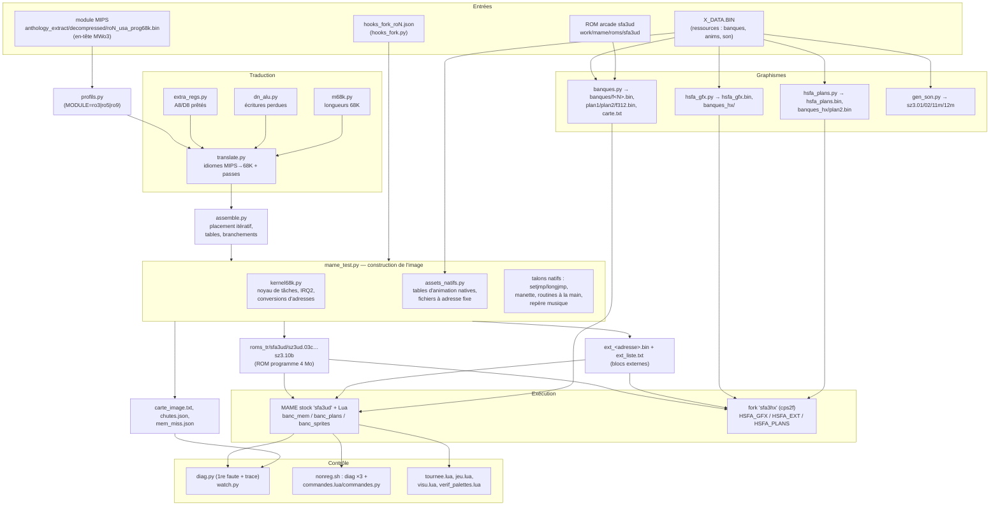

# Architecture des outils — Hyper SFA / Anthology → CPS2

> **Emplacements dans le dépôt** (réorganisation du 2026-10-11) : scripts Python = [`src/hsfa/`](../../src/hsfa/README.md),
> scripts Lua du banc = `src/hsfa/mame/`, scripts de validation = [`scripts/validation/`](../../scripts/validation/),
> patch du fork = [`patches/mame-fork/`](../../patches/mame-fork/README.md). Vue d'ensemble plus courte :
> [traducteur.md](traducteur.md).

> Documentation de référence des outils de retraduction MIPS → 68000 de *Street Fighter Alpha Anthology* (PS2),
> du banc MAME (scripts Lua) et du fork MAME `sfa3hx`. Rédigée le 2026-10-04 **à partir du code** (copie de travail
> `<workspace>/scripts/untranspile/`, scripts Lua de `<workspace>/work/mame/`, fork
> `<workspace>/mame-fork/mame/`), recoupée avec le journal `<workspace>/github/docs/journal/HANDOFF.md` (§1-§121).
>
> Conventions : « §N » = série canonique du HANDOFF (voir `INDEX-HANDOFF.md` §0) ; « va » = adresse dans le fichier
> du module MIPS (adresse d'exécution PS2 − `0x1F0000`) ; « mode cps2 » = recette mémoire universelle (§29, §32) ;
> les adresses `$xxxx` sont 68K, `0xxxxx` MIPS/PS2. Les incohérences relevées sont regroupées au **§7** et
> signalées sur place par ⚠.

## Sommaire

1. [Vue d'ensemble du pipeline](#1-vue-densemble-du-pipeline)
2. [Fiches des scripts Python actifs](#2-fiches-des-scripts-python-actifs)
3. [Scripts historiques ou d'analyse](#3-scripts-historiques-ou-danalyse)
4. [Banc Lua et fork MAME](#4-banc-lua-et-fork-mame)
5. [Formats de données](#5-formats-de-données)
6. [Recettes](#6-recettes)
7. [Incohérences code ↔ journal et points fragiles](#7-incohérences-code--journal-et-points-fragiles)
8. [Où regarder pour… (index par sujet)](#8-où-regarder-pour-index-par-sujet)

---

## 1. Vue d'ensemble du pipeline

### 1.1 Le principe

L'Anthology contient SFA3 (`ro3`), Upper (`ro5`) et Hyper (`ro9`) sous forme d'une **recompilation statique
68000 → MIPS R5900** : chaque registre 68K vit dans une case du scratchpad (`0x70001100…`), les drapeaux aussi.
Les outils **reconnaissent les idiomes stéréotypés du recompilateur et réémettent l'instruction 68000 d'origine**
(ce n'est pas un décompilateur), assemblent le résultat, ajoutent un petit noyau 68K qui remplace les fils PS2, et
produisent une ROM programme CPS2 qui remplace celle du jeu Phoenix `sfa3ud` dans MAME. La ROM arcade de SFA3 sert
de corrigé ; Upper et Hyper n'en ont pas.

### 1.2 Schéma

Lecture en une phrase : **`mame_test.py`** (point d'entrée de la construction) lit le profil du module, appelle
**`assemble.assemble()`** qui appelle **`translate.translate()`** sur toute la zone 68K du module, pose autour du code
le noyau et les talons, recopie les données du module, et écrit la ROM et ses fichiers annexes ; le **banc** (MAME
stock + Lua) ou le **fork** (`sfa3hx`) l'exécute ; **`diag.py`** remonte d'une exception à l'instruction MIPS fautive
grâce à `carte_image.txt` ; **`nonreg.sh`** rejoue les trois diagnostics et le test des commandes.

### 1.3 Les modules (profils)

| Module | Jeu | Fichier | Code 68K recompilé | Fin du code (en-tête +12) | Fin des données (+24) | RAM PS2 | Dossier de travail |
|---|---|---|---|---|---|---|---|
| `ro3` | SFA3 | `ro3_usa_prog68k.bin` | `0x22B00` | `0x393C40` | `0x88C700` | `0x900000` | `work/mame` |
| `ro5` | Upper | `ro5_usa_prog68k.bin` | `0x22B00` | `0x41ACC0` | `0x9A0180` | `0xA00000` | `work/mame_ro5` |
| `ro9` | Hyper | `ro9_usa_prog68k.bin` | `0x22DE0` | `0x3BF140` | `0xB67200` | `0xB80000` | `work/mame_ro9` |

(en-têtes relus sur disque ; base de chargement = `0x1F0000` pour les trois ; RAM = `ram_hi_of()`, arrondi au
multiple de `0x80000` au-dessus de la fin des données, §30.) Entre `0x20` et `0x22B00`, il y a du **Z80 recompilé**
(son), jamais retraduit (§16).

### 1.4 Carte de l'image 68K produite (ROM programme de 4 Mo)

Déduite de `mame_test.py` et `kernel68k.py` (valeurs ro3 ; ro5/ro9 indiqués quand ils diffèrent).

| Adresse 68K | Contenu | Produit par |
|---|---|---|
| `$000000-$0000FF` | vecteurs : SP = `PILE` (défaut `$664000`), PC = `$900`, niveau 2 (`$68`) = IRQ2 du noyau, tous les autres → boucle `$A00+2v` | `mame_test.main` |
| `$000400-$0007FF` | routines « convertir An » des **pointeurs de données PS2** (`DPTR_FIX`, §63, arbre dichotomique §104) | `kernel68k.build_conv` |
| `$000800` / `$000802` | `STUB_RTS` (RTS de repli des appels natifs non raccordés) / RTE | `mame_test` |
| `$000810-$0008FF` | talons des tables d'animation natives (un par site, talon « perso », talons dynamiques §108) ; **ro3** : puis setjmp/longjmp et couche manette | `mame_test` + `assets_natifs` |
| `$000900-$000927` | amorçage : `LEA $FF8000,A5 ; JSR reset ; JSR init ; MOVE #$2000,SR ; JMP ordonnanceur` | `mame_test` |
| `$000940-$0009FF` | **ro5/ro9** : talons setjmp/longjmp et manette | `mame_test` |
| `$000A00-$000A7F` | 63 boucles `BRA.S *` (une par vecteur d'exception) : signature d'une faute pour `diag.py` | `mame_test` |
| `$000B00-$000FFF` | **noyau de tâches** (CREER, CEDER, FINIR, LANCER, ordonnanceur, IRQ2) | `kernel68k.build` |
| `$001000-…` | **code traduit** | `assemble.assemble` |
| `DATA_BASE` (aligné 4 Ko après le code) | données du module, octets de chaque mot inversés (LE16 → BE16), jusqu'à `DATA_SPLIT` | `mame_test` |
| `ASSET` (après les données) | bloc des fichiers « anim » décompressés + table perso → pointeur | `assets_natifs.build` |
| `$3C0000-$3DFFFF` | table de **hachage** adresse de code PS2 → 68K (16 384 × 8 o, §98) ; absente si `CODECONV_DICHO=1` | `kernel68k.build_hash` |
| `$3E0000-$3FEFFF` | table triée (adresse PS2, adresse 68K) des débuts de fonction (`CODEMAP`, §76) | `mame_test` |
| `$3FF000-` | routines « convertir An » des **adresses de code** (`CODECONV`, hachage puis dichotomie) | `kernel68k.build_code_conv` |

Hors ROM programme :

| Adresse | Contenu |
|---|---|
| `$618000-$619FFF` | mémoire partagée QSound (RAM PS2 + `0x60000`, §58) |
| `$660000-$6637FF` | piles des 16 tâches (`$660000 + (n+1)×$380`) |
| `$663800` / `$663880` / `$663884` / `$663888` | `SIDE` (pile sauvée, entrée) / `SCHEDSP` / `CURSLOT` / `FLAG` (compteur d'images) |
| `$663890-$6638A7` | tampons setjmp/longjmp (3 tampons dans les trois modules) |
| `$6638F0` | `EXCMARK` : PC d'un talon d'exception interrompu par l'IRQ2 (lu par `diag.py`, `tournee.lua`) |
| `$664000` | sommet de la pile de l'ordonnanceur / du programme |
| `$700000`, `$708000` | mémoire d'objets (deux pages) |
| `$900000-$92FFFF` | mémoire vidéo CPS2 (RAM PS2 + `0x20000`) |
| `$A04000` / `$B04000` / `$C84000` | fichier de frames de sprites à adresse fixe : 289 (ro3) / 390 (ro5) / 547 (ro9) → `ext_*.bin` |
| `$B00000-$BFFFFF` | blocs des persos MAX (`banques_max.py`, en pause) |
| `DATA_EXT` | fin des données quand le programme dépasse 4 Mo : `$C80000` (défaut, ro5 : depuis `0x8E4AE0`, début du bloc du perso `$1F`, §126) / `$940000` (ro9) |
| `$F00000-` | `PORT_RAM` : variables du portage (sous la RAM PS2, puis après la vidéo à `+$80000`) |
| `$FF0000-$FFFFFF` | RAM de travail (RAM PS2 `0x00000-0x0FFFF`) |
| `$01xxxxxx` | adresses matérielles **marquées** (`HW_TAG`, octet haut `$01` ignoré par le bus 24 bits) pour ne pas être reconverties (§63) |

---

## 2. Fiches des scripts Python actifs

Ordre : configuration → traduction → assemblage → construction → contrôle → graphismes/son.
« Appelé par / appelle » ne liste que les liens réels (imports ou `subprocess`).

### 2.1 `profils.py` — profil par module

- **Rôle** : centralise les constantes propres à chaque module (points d'entrée, adresses des aides du
  recompilateur, sites de manette, routines patchées…). **Toute valeur absente ou `None` désactive la
  fonctionnalité correspondante** pour ce module.
- **Entrées** : `MODULE` (`ro3` défaut, `ro5`, `ro9`), `TRAVAIL` (remplace le dossier de travail, pour des essais
  isolés).
- **Sorties** : `P` (dictionnaire du module), `NOM`, `chemin()` (chemin du module MIPS), `EXTRACT`.
- **Clés** : `fichier`, `va_reset`, `va_frame` (⚠ lu mais inutilisé par `mame_test`), `va_init`, `irq2` ou
  `irq2_dans` (adresse *dans* la fonction VBL, ro3), `sauve_regs` (routines de sauvegarde de registres → RTS),
  `hooks` (JSON de `hooks_fork.py`), `manette` (site → `(décalage, src, dst)`), `aides` (adresse → `movem_push`,
  `movem_pop`, `andi_ccr`, `abcd`), `be48` (déplacement A5 du pointeur d'animation : `$BE48` ro3, `$C0BC` ro5/ro9),
  `musique` (début, suite, index de la table de ticks, §103/§118), `objets_intro` (§103), `palettes` (table moteur,
  §105/§119), `mains` (routines réécrites à la main, ro3 seulement), `data_ext` (ro9 : `$940000`), `blocs`
  (§126, ro5 : `(0x61A100, 32)` = table des blocs de données par perso ; la coupure des données en bloc externe
  tombe au début d'un bloc, car le code calcule `table + décalage 16 bits` à l'exécution), `travail`, `sortie`.
- **Journal** : §108 (création), §114, §118, §119, §121 (ro9).
- **Appelé par** : `mame_test`, `diag`, `hsfa_gfx`, `hsfa_plans`.

### 2.2 `mips.py` — décodeur MIPS R5900

- **Rôle** : décodage par champs de bits, sans capstone. Classe `Ins` (`va, w, op, rs, rt, rd, sa, fn, imm, simm,
  tgt, m`), générateur `decode(buf, start, end)`, `code_bounds(buf)`.
- **Constantes** : `CODE0 = 0x22B00` (début 68K, ⚠ faux pour ro9 qui commence à `0x22DE0`, voir §7), `CODE1 =
  0x393C40` (fin ro3), `Z80_0/Z80_1`.
- **Journal** : §4, §16.
- **Appelé par** : presque tous les scripts.

### 2.3 `m68k.py` — longueurs d'instructions 68000

- **Rôle** : calcule la taille d'une instruction 68000 et la nature de ses mots d'extension (`imm` / `disp` /
  `abs`), sans désassembler. `ea_words`, `ea_kind`, `decode_one(w, i, n)`, `walk(buf, start, end)`.
- **Utilisé par la construction** : les passes de `translate.py` (`_shorten`, `_rewrite_ea`, `merge_postinc`,
  `byte_streams*`) s'en servent pour retrouver la frontière des instructions dans la sortie.
- **Appelé par** : `translate`, `verify`, `chain`, `propagate`, `reach`, `opclass`…

### 2.4 `translate.py` — le traducteur (3 373 lignes)

**Rôle** : `translate(buf, start, end)` rend `(out, unknown)` où `out` est une liste de triplets
`(va_mips, mnémonique, [mots 68K])`. Une simulation symbolique légère suit ce que contient chaque registre MIPS ;
quand un motif complet est reconnu, l'instruction 68000 est émise. Les éléments à 0 mot servent de libellés.

**⚠ Contrat textuel avec `assemble.py`** : l'assembleur relit des **marqueurs dans le mnémonique** — `(cible xxxx)`
(branchement), `[mips xxxx]` / `[cible xxxx` (appel externe), `T_xxxxxx` (table PC-relative), `CODE_xxxxxxx` et
`_ECH` (pointeur de code, long échangé), `prete]` (ouverture de zone A8). Modifier un format de mnémonique peut casser
l'assemblage sans erreur visible.

**Entrées** : le module (bytes), `[start, end)` en va. **Variables d'environnement** : `MEMMODE` (`hote` défaut ;
`cps2` imposé par `mame_test` ; `type` expérimental), `EXTRA_REGS` (1), `A8_HOME` (`87e0`, `none` = ancien
comportement), `D8_HOME` (`87f0`), `LONG_POSTINC` (1), `DROP_SR` (1), `BYTE_PRE` (1), `DN_ALU` (1 ; coupe aussi
`mem_fix`), `MASQ_OK` (liste blanche de masques 32 bits, diagnostic), `TYPE_REGS` (`5,6`, mode `type`), `AUDIT_MEM`
(1 → `MEM_MISS`), `DBG_VA`, `DBG_RANGE` (traces).
Ajouts §126 (tous à 1 par défaut, `=0` rend l'ancien comportement) : `FTC_AVANT` (test rendu à l'appelant placé avant
les restaurations d'un épilogue partagé), `TBL_TST` (valeur de table seulement testée), `EXG_PILE` (échange An↔Am
par un temporaire de la pile MIPS), `SW_X4` (aiguillage à index déjà ×4), `LUI_IMM` / `CONST_OP` (constantes `lui`
seule, `lui+ori/addiu`, `sw zero` / `lui` rangés sur la pile, comme opérandes de comparaison exacte). Ajout §128 : `EXT_MEM`
(lecture signée `lb`/`lh` rangée plus large dans un registre D → `MOVE` + `EXT`, compteur `EXT_MEM_N`).

**Globales réglées par `mame_test` avant l'appel** : `AIDES_RECOMP`, `DATA_EXT`, `HW_TAG`, `DPTR_FIX`, `DATA_BASE`,
`DATA_SPLIT`, `CODE_CONV`. **Globales lues ensuite par `mame_test`** (compteurs à un élément) : `LONG_POSTINC`,
`VRAM_SHIFT`, `IDX_X4`, `LONG_SR`, `ABS_AN`, `ADDA_MEM`, `DN_ALU`, `MEM_FIX`, `BYTE_ADDA`, `BYTE_PRE`,
`FTC_AVANT_N`, `TBL_TST_N`, `EXG_PILE_N`, `SW_X4_N`, `LUI_IMM_N`, listes `CHUTES`, `MEM_MISS`, **`EXACT_MISS`** (§126 :
blocs « drapeaux exacts » reconnus mais dont un opérande est inconnu → comparaison perdue ; écrit par `mame_test`
dans `<travail>/audit_exacts.txt` ; ro3 0, ro5 10 restants) ; `_CODE_STARTS['set']` (débuts de fonction), `TABLES` (tables d'aiguillage lues),
`ZONE_OPEN` (lu par `assemble`).

#### 2.4.1 Modèle du banc de registres (version juste, §11, §53)

| Case `0x7000xxxx` | Registre 68K | Remarque |
|---|---|---|
| `0x1100-0x111C` | A0-A7 | A7 = pile MIPS du portage : écritures absorbées (§59) |
| `0x1120` | **A8** (registre supplémentaire) | prêté à un An libre ou « domicile » `$87E0(A5)` |
| `0x1124-0x1140` | D0-D7 | |
| `0x1144` | **D8** | prêté à un Dn libre ou domicile `$87F0(A5)` |
| `0x114C` | pile privée | `private_stack()` → pile 68K (§72) |
| `0x1150` | RES (Z, N) | `RES_SLOT` |
| `0x1154` | X | `X_SLOT` |
| `0x1158` | **C (retenue)** | constante nommée `NFLG_SLOT` avec le commentaire « signe (flag N) » ⚠ trompeur (§7) |

`slot_name(off)` → `('A'|'D', n)` ; `ACTIVE_EXTRA` redirige A8/D8 vers le registre prêté de la zone en cours ;
`an_slots(n)` = cases désignant An (la sienne + A8 si prêté sur An).

#### 2.4.2 Conversion des adresses (mode cps2)

- `mconv(disp, size, an)` : octet → déplacement XOR 1 (recette cps2) ; mode `type` : `typed_rule.predict_typed`.
- `addr_to_68k(v)` / `_addr_to_68k(v)` : adresse PS2 → 68K. Ordre : registres matériels `HWREG` (variables du
  portage → vrais registres CPS-A/B, entrées `$804000…`, §57/§62/§80) ; `ADDRMAP` (RAM → `$FF0000`, QSound →
  `$618000`, objets → `$700000/$708000`, vidéo → `$900000`) ; fin des données → `DATA_EXT` (si `DATA_SPLIT`) ;
  données → `DATA_BASE` ; variables du portage → `PORT_RAM`. `HW_TAG` ajoute `$01000000` aux adresses matérielles.
- `abs_addr(host, size)` : adresse absolue + XOR 1 pour un octet, sauf `BYTE_EXACT` (ports d'entrée).
- `WIDEREG` : registres de base CPS-A élargis à 32 bits par le portage. `INPUT_INV` : vide depuis §80.
- `set_module_bounds(buf)` lit `CODE_END_RT` / `DATA_END_RT` dans l'en-tête ; `code_end_translate(buf)` prolonge
  jusqu'au `jr ra` qui suit la fin annoncée (§76) ; `ram_hi_of(buf)`.
- `mips_to_68k(va)` + `_load_map()` : interpolation par morceaux sur `map_chain2.json` / `map_ro3_sfa3.json`
  (héritage de la phase « carte », R§5/C1-C5). Dans la construction, la valeur n'est **pas utilisée** : `assemble`
  relit la cible dans `[mips xxxx]` et la résout lui-même.

#### 2.4.3 Pré-passes sur le flot MIPS (avant la boucle)

| Fonction | Ce qu'elle fait | § |
|---|---|---|
| `unaligned_pairs(L)` | paires `swl/swr` (`lwl/lwr`) à déplacement pair non multiple de 4 → `sw`/`lw` synthétique | §67 |
| `slot_ori(L)` | case adressée par `ori rX,rL,off` (rL = `lui 0x7000`) → forme habituelle | §78 |
| `hautes_moities(L)` | accès `lh/sh` à la moitié haute d'un Dn → pseudo-instruction `swapd` (émise `SWAP Dn`) | §82 |
| `private_stack(L)` | empilements/dépilements sur la pile privée `0x114C` → `MOVE.L Rn,-(SP)` / `(SP)+` | §72, §77 |
| `extra_zones(buf)` → `extra_regs.plan` | zones où A8/D8 reçoivent un registre prêté | §53-§54, §80 |
| `empty_funcs(buf)` | fonctions réduites à `jr ra` (appel terminal vers elles = `RTS` partagé) | §47 |
| `_CODE_STARTS` | débuts de fonction par prologue `addiu sp,-N ; sd ra` (cibles de pointeurs de code) | §76 |

#### 2.4.4 Suivi symbolique (boucle principale)

Dictionnaires remis à jour à chaque instruction : `st` (registre MIPS → `Sym(kind, val, sz)`), `lui`, `memread`
(lecture `d16(An)`), `absread` (lecture absolue), `idxread` / `idxbig` (lecture indexée `d8` / `d16`), `ldsize`,
`spill` (temporaires rangés sur la pile MIPS, suivis à travers), `REG68`. Genres de `Sym` : `imm`, `const`, `an`
(An + déplacement), `an_d`, `reg68`, `arithi`, `sub`, `zx`, `memadd`, `memarith`, `memlogic`, `dmem`, `tblidx`,
`tblent`, `dynbit`, `neg`, `shift`, `scaled`, `flag`. **Invalidation** : `dest_reg(ins)` efface l'information de la
destination, sauf propagation à travers les décalages d'extension de signe (`_SHIFT_KEEP`) ; les sources sont
**photographiées avant** l'invalidation (`SM`, `SAB`, `SL`, `SI`) pour le cas `andi v1,v1,…`.

#### 2.4.5 Familles de reconnaissances (dans `translate()` et ses aides)

**Drapeaux et branchements**

- Test différé `pend` : l'écriture de RES (`sw RES`) pose un test en attente (`tst_mem`, `tst_dn`, `tst_abs`,
  `tst_idx`, `cmp`, `btst`, `btst_dn`, `btst_dyn`) que le Bcc suivant matérialise (`TST`/`CMP`/`BTST` + Bcc) ;
  supprimé si l'opération émise a déjà posé les drapeaux (`flags_set`, `moved`, `arith_written`, `last_sub`).
- Correspondances `BCC_OF` (Z/C × beq/bne/bltz/bgez/bgtz/blez) et `SIGNED_OF` (N⊕V → BLT/BGE/BGT/BLE, §20).
- Blocs internes du recompilateur absorbés : `carry_block` (calcul de C par `sltu`), `exact_flags` (variante
  « drapeaux exacts », §20), `full_flags_block` (recompilateur récent d'Upper/Hyper, §52), `derives_from` (§75).
- `flags_to_caller` : test rendu à l'appelant devant `RTS` ou devant un `BRA` vers l'épilogue (§66, §80, §87, §93,
  §114). `flags_read_first`.
- Signe d'une valeur modifiée en place → `BPL/BMI` (§73) ; « DBRA » du recompilateur = `SUBQ ; BPL` (≥ 0, §74).
- `beq zero,zero` = `BRA` (§63) ; `bne +2 ; j loin` refusionné par l'assembleur (§37).
- Résultat natif `jal f ; beq/bne v0,zero` : `v0` supposé nul (§65).
- Test de bit différé dont l'octet est réécrit avant le Bcc : drapeaux sauvés (`MOVE SR` … `MOVE (SP)+,CCR`,
  compteur `N_BTST_CONFLIT`, §80).

**Appels et retours**

- `jal` / `jalr` vers constante → `JSR/JMP $x.L [mips x]` ; appel terminal par `tail_return` (retour immédiat) ou
  `tail_branch` (saut vers l'épilogue commun) → `JMP` (§6, §9) ; terminal vers une fonction vide → `RTS` (§47).
- Aides du recompilateur (`AIDES_RECOMP`, `aide_recomp`) : `MOVEM` à masque, `ANDI #,CCR`, `ABCD` octet par octet
  (§83).
- `lw r,An ; jalr r` → `JSR (An)` / `JMP (An)` précédé de `JSR CODE_CONV[n]` (adresses de code PS2 converties à
  l'usage, §70, §76).
- Aiguillage d'état Capcom : `jalr` sur une entrée de table (`tblent`) → `MOVE.W T(PC,Dn.W),Dm ; JMP/JSR T(PC,Dm.W)`,
  table lue par `read_jump_table` et bornée par `data_refs` (§15) ; index brut ×4 doublé (§102).
- `jr ra` → `RTS`, absorbé s'il clôt un appel terminal, conservé s'il est cible d'un branchement
  (`epilogue_is_target`, §64).

**Registres d'adresse**

- `movea_fixup` : la conversion « +0x900000 » ajoutée par le recompilateur après un `MOVEA.W` est absorbée (§10).
- `MOVEA.W An,Am` (§86), `MOVEA.L abs.L,An` (§106, `ABS_AN`), `ADDA.W d(An),Am` (`adda_mem`, §107, `ADDA_MEM`),
  `MOVEA.L T(PC,Dk.W),Am` sur table de pointeurs (§67) et index brut ×4 (§112, `IDX_X4`), `ADDA.W T(PC,Dk.W)` (§83),
  `LEA T(PC,Dn.W),Am` (`lea_table_index`, §65), `EXG` (§42, §80), `movea_l_mem` (long échangé), réalignement
  `(An+3)&~3` du portage conservé (§63), recalage des registres MIPS qui gardent l'ancienne valeur d'An.

**Données, arithmétique, logique**

- `MOVE` mémoire↔registre↔mémoire (`enc_move_*`), `MOVEQ` (`enc_imm_dn`), `CLR` (`enc_clr_an`), `ADDQ/SUBQ/ADDI`
  (`enc_addimm_dn`), arithmétique registre-registre (`enc_arith`), `Dn OP mémoire` et `mémoire OP= Dn`
  (`enc_op_mem_dn`, `enc_op_dn_mem`), opérations en place (`enc_addsub_mem`, `enc_logic_mem` → `BSET/BCLR/BCHG` ou
  `ORI/ANDI/EORI`), `SUBI` en place (§90), `SUB.x Dk,d(An)` (§78).
- Décalages (`enc_shift_dn`, `LSL` préféré), rotations (`rot_of` → `ROR/ROL`), `NOT` (`nor`, §80), `NEG`,
  extension de signe en place `EXT.W/EXT.L` (`sign_ext_inplace`, §67), `ADDX` (`addx_at`, §77).
- Octets inversés et moitiés : `is_swap`, `swap_or` (SWAP assemblé pour un rangement naturel, §83), `bswap32_or`
  (long rangé octet par octet, §90), `bswap16_mem` / `bswap16_of` (mot à octets inversés, §92, §100), `ROR.W #8`
  vers mémoire (§77).
- Constantes : `lui` seul (`lui_only`, `ADDI.L #$16000000`, §85), masques 32 bits `lui ; ori` (`_masque_ok`, §83),
  constante impaire jamais prise pour une adresse (§101), constante-adresse dans `CMPI.L` convertie (§88), immédiat
  découpé en deux `addiu` (§80).
- Tests de bit statiques (`enc_btst_an`, `btst_target` : bon octet d'un mot) et dynamiques (`enc_dynbit`, §80).
- Accès indexés `d8(An,Dn)` (`idx_ext`) ; `d16(An,Dn)` hors portée → adresse exacte calculée (`idxbig_seq`, §78) ;
  lecture absolue propagée par l'extension de signe (QSound `$61801F`, §118).

**Recette cps2 (octets XOR 1, longs à moitiés échangées)**

- Long en mémoire : `SWAP` autour des `MOVE.L` registre↔mémoire ; `CMPI.L` contre la valeur réelle (`enc_cmp`,
  §80) ; opération en place sur un long (`inplace_long`, §80, §104) ; `MOVE.L An,d(Am)` (§67, §80).
- Octet lu en demi-mot puis comparé en octet → XOR 1 (`enc_cmp._fixb`, §69/§70).
- Écriture d'une constante de pointeur de code : `MOVE.L #CODE_x_ECH` (valeur PS2 échangée, convertie à l'usage).

**Rattrapages (`dn_alu.py`)** : quand une écriture de case D ou A n'a rien produit, `dn_alu()` / `a_alu()` essaient
des formes supplémentaires ; sinon la chute est consignée dans `CHUTES` (§107, compteur « écritures de registre
tombées »).

#### 2.4.6 Post-passes (sur la liste `out`, dans cet ordre)

| Passe | Effet | Condition | § |
|---|---|---|---|
| `dn_alu.mem_fix` | insère les écritures mémoire restées sans trace | `DN_ALU≠0` | §107 |
| `$0000(A` → `(A` + `zero_disp_short` / `_shorten` | `d16(An)` nul → `(An)` | toujours | §36 |
| `merge_postinc` | `ADDQ #s,An` + accès `-s(An)` → `(An)+` ; `SUBQ` + `(An)` → `-(An)` | toujours | §36 |
| `merge_long_postinc` | long lu en deux moitiés par post-incrément → `MOVE.L (An)+,Dm` | cps2, `LONG_POSTINC≠0` | §103 |
| `vram_shift_const` | adresse vidéo formée par décalage → constante convertie | cps2 | §110 |
| `drop_dead_sr` | retire la sauvegarde de SR d'un `inplace_long` si l'instruction suivante écrase NZVC | cps2, `DROP_SR≠0` | §104 |
| `byte_streams` | flux d'octets `(An)+` : adresse exacte à l'exécution | cps2 | §65 |
| `byte_streams_pre` | flux d'octets décroissant `-(An)` | cps2, `BYTE_PRE≠0` | §121 |
| `byte_index_exact` | octet indexé `d8(An,Xn)` à index impair : adresse exacte | cps2 | §66 |
| `byte_after_adda` | octet via An de parité inconnue après `ADDA` | cps2 | §97 |
| `dptr_fix` | `MOVEA.L <mémoire|Dn>,An` + `JSR CONV_An` (pointeurs PS2 des données) | `DPTR_FIX` non vide | §63 |
| audit `MEM_MISS` | stores sans trace dans la sortie | `AUDIT_MEM=1` | §107 |

#### 2.4.7 Autres

- Encodeurs : `enc_btst_an`, `enc_clr_an`, `enc_cmp`, `enc_move_mem_mem`, `enc_move_reg_dn`, `enc_move_pcidx`,
  `enc_sub_dn`, `enc_tst_an/dn`, `enc_jsr_abs`, `enc_jmp_abs`, `enc_movea_*`, `enc_lea_*`, `enc_adda_dn`,
  `enc_addq_an`, `enc_immop_dn`, `abs_words`, `swap32`, `bs32`.
- Mode `type` (`mconv`, `rev_field`, `type_const`, `typed_rule`, `layout_rule.access_stats`) : modèle « typé par
  champ » du §44, **jamais généralisé** ; non utilisé par la construction.
- `__main__` : traduit l'ancre `0x201FA8` et la compare au 68K `0x9350` de `work/cps2/sfa3_prog.bin`.
- **Appelé par** : `assemble`, `mame_test`, `census`, `natmiss`, `verify`, et la plupart des scripts d'analyse.
  **Appelle** : `mips`, `m68k`, `extra_regs`, `dn_alu`, (mode `type`) `layout_rule`, `typed_rule`.

### 2.5 `extra_regs.py` — registres A8/D8 prêtés

- **Rôle** : A8 (`0x1120`) et D8 (`0x1144`) n'existent pas sur 68000. `plan(buf)` découpe chaque usage en **durées
  de vie** et rend, par fonction, des zones `(genre, registre 68K, case, début, fin)` traduites par
  `MOVE.L Rk,-(SP)` … `MOVE.L (SP)+,Rk` (ou via les domiciles A8 `$87E0(A5)` / D8 `$87F0(A5)`). Conditions : pas
  d'appel dans la zone, entrée/sortie uniques, registre libre (dans la fonction, ou au moins dans la zone : sauvé /
  restauré).
- **Fonctions** : `analyse(buf)` (ancienne méthode par fermeture du graphe d'appels, ⚠ décrite par la docstring
  du module mais **non utilisée** par la construction) ; `plan(buf)` (utilisée via `translate.extra_zones`).
- **Mécanismes de `plan`** : nouvelle durée de vie à chaque écriture « fraîche » ; fusion « si / sinon »
  (`MERGE_IFELSE`, §114, compteur `MERGED`) ; découpage de A8 autour des appels (domicile, §80) ; extension de la zone
  aux retours de boucle et à la dernière utilisation des registres MIPS dérivés (§66, §73) ; fermeture anticipée
  `EARLY_CLOSE` (§80) ; retour de boucle venant d'après la zone (`BACK_AFTER`, §121, compteur `BACK_AFTER_N`).
- **Variables** : `A8_HOME` (`none` désactive le plan domicile), `MERGE_IFELSE`, `BACK_AFTER`, `LOOP_EXT` (portée du
  retour de boucle après le dernier accès, `0x100` ; `0x40` avant §126), `PARTIAL_LIVE` (0 ; essai : `sb`/`sh` ne
  coupent pas une durée de vie), `LATERAL` (1, §130 : sorties latérales acceptées, réécrites par `translate`), `DBG_PLAN=lo-hi`, `MODULE` (`__main__`).
- **Usage autonome** : `MODULE=ro3 python3 extra_regs.py plan` (statistiques des zones et refus).
- **Journal** : §53, §54, §65, §66, §72-§73, §80, §114, §121.

### 2.6 `dn_alu.py` — écritures perdues (audit §107)

- **Rôle** : formes MIPS → 68K non reconnues ailleurs, appelées quand une écriture de registre n'a rien émis.
- **Fonctions** :
  - `dn_alu(L, i, n, size, tbl_ok)` : `ADDI` (chaîne d'`addiu`), `ANDI.L` (paire `dsll32/dsrl32`), `MULS.W #k`
    (`x*5 << s`), décalages variables `LSL/ASR/LSR Dm,Dn`, `ADD.x Dn,Dn`, `ADDI/ANDI/ORI #c`, `OP.x T(PC,Dk),Dn`.
  - `a_alu(L, i, am, bswap16_of)` : `SUBA.L Dk,Am`, `LEA d16(An),Am ; ADDA Dk,Am`, `ADDA.L` d'un mot à octets
    inversés via D0.
  - `mem_fix(L, out, inplace_long, abs_addr, addr_to_68k)` : insère des écritures mémoire perdues (long en place,
    `ANDI.W #c,abs.L`, octet signé de table vers un champ, long non aligné `swr/swl`).
  - aides : `_prod` (producteur d'un registre), `_dest`, `_orig` (remonte extensions de signe et masques),
    `_slot_d`, `_slot_a`, `_const`, `_imm`.
- **Variable** : `DN_ALU=0` coupe `dn_alu`, `a_alu` **et** `mem_fix`.
- **Appelé par** : `translate`.

### 2.7 `assemble.py` — assembleur 68000 à placement itératif

- **Rôle** : `assemble(buf, start, end, base, external, native)` traduit `[start, end)` puis place et encode. Rend
  `(its, words, unresolved)` : éléments (`Item` : `va, mn, ws, kind, tgt, cond, choice, off, host…`), mots 68K,
  nombre de références non résolues.
- **Étapes** :
  1. `classify(items, buf)` : genres `fixed`, `bcc`, `call`, `jump`, `switch` (JMP/JSR `T(PC,Dn)`), `tblref`
     (`MOVE.W T(PC,Dn),Dm`), `dtab` (table de données PC-relative), `codeptr` ; refusion `Bcc +2 ; JMP loin` en
     B(cond inverse) loin, sauf si le saut est lui-même cible (§91) ; choix de l'hôte de chaque table (après le
     JMP, après la prochaine rupture, ou `skip` = table sautée par un BRA).
  2. Relaxation (30 tours max) : branchements courts → longs → `far` (`B!cc.S +6 ; JMP abs.L`, §70/§71) ; appels
     `BSR.S/BSR.W/JSR.L`, sauts `rien/BRA.S/BRA.W/JMP.L` (rien = la cible est l'instruction suivante) ; entrées de
     table hors de portée 16 bits → tremplins `JMP abs.L` après la table (`FAR_ENT`, §93/§94) ; tables de données
     hébergées hors portée d8 → `inline`.
  3. Émission : une **copie de table par aiguillage** (§63), tables `BRA.S` (`BRAS_TABLES`), tables de données en
     forme absolue (`DTAB=abs` : `LEA données.L,An`, octet à adresse exacte + XOR 1 à l'exécution, §63/§80),
     pointeurs de code (valeur PS2 si `CODE_CONV`, échangée si `_ECH`), conversion `DPTR_FIX` après un `MOVEA.L`
     lu dans une table de pointeurs (`dtab_fix`).
- **Aides** : `table_bytes`, `table_size`, `dtab_fix`, `base_size`, `size`, `dtab_start`.
- **Libellés** : une cible MIPS désigne la **première** instruction 68K émise à partir d'elle ; exception : retour de
  boucle interne à une zone A8 → après l'ouverture (`translate.ZONE_OPEN`, §80).
- **Variable** : `DTAB` (`abs` défaut). **Globales** : `BRAS_TABLES`, `FAR_ENT` (lu par `mame_test` pour le compte
  rendu).
- **Journal** : §37, §55, §63, §64, §70-§71, §75, §80, §91, §93-§94.
- **Appelé par** : `mame_test`, `link`, `build_rom`, `e2e`, `diverge`… **Appelle** : `translate`.

### 2.8 `kernel68k.py` — noyau de tâches et conversions d'adresses

- **Rôle** : générateur de code machine 68000 (mini-assembleur `Asm` : `L`, `emit`, `bra`, `jsr`, `jmp`, `done`).
- **`build(org, vbl_addr, n_slots=16, code_conv)`** : noyau coopératif calqué sur celui de Capcom (ROM
  `$1110…`), sur la table des tâches **du portage** (`A5+$8184`, 16 × `$20`, état = octet +1, courante `A5+$8388`).
  Points d'entrée rendus : `creer` (CreateThread, D0 = emplacement×$20, A0 = entrée), `ceder` (SleepThread),
  `finir` (ExitThread / ExitDeleteThread), `lancer`, `ordo` (ordonnanceur au premier plan, attend `FLAG`), `irq2`
  (marque `EXCMARK` si un talon d'exception est interrompu, `JSR` VBL porté, `FLAG+1`, `RTE`).
- **`build_conv(org, ranges)`** : routines « convertir An » des **pointeurs de données PS2** (plages
  `(début, fin, ajout)` ; drapeaux et registres préservés ; arbre dichotomique, §104).
- **`build_code_conv(org, table, n, lo, hi, hash_addr)`** : « convertir An » des **adresses de code PS2** (hachage à
  sondage linéaire si `hash_addr`, sinon dichotomie ; §76, §98). `code_hash(k) = ((k>>2) ^ (k>>8)) & $3FFF` ;
  `build_hash(pairs)`.
- **`disasm(code, org)`** : désassemblage capstone (seulement dans `__main__` ; ⚠ la docstring dit « vérifié par
  désassemblage capstone », ce n'est pas automatique).
- **Journal** : §60-§61, §63, §76, §80, §98, §104.
- **Appelé par** : `mame_test`.

### 2.9 `assets_natifs.py` — ressources chargées par le code natif

- **Rôle** : le portage a sorti de la ROM des tables d'animation (intro, une par perso) chargées par des fonctions
  natives à une adresse fixe (`LOAD_BASE`, pointeur rangé en `$BE48(A5)` / `$C0BC(A5)`). On décompresse ces fichiers
  « anim » (MWo3/LZSS), on les range dans un bloc à base virtuelle `VBASE` (pointeurs relogés), projeté par la
  conversion de pointeurs ; les appels natifs deviennent des talons 68K. Gère aussi les **fichiers à adresse fixe**
  (`FIXES` : 289 → `$A04000` ro3, 390 → `$B04000` ro5, 547 → `$C84000` ro9).
- **Fonctions** : `fichier(n)` (cache `work/cps2/anims/f<N>.bin`, sinon `X_DATA.BIN` via `XDATA` ; écrit le cache),
  `tables(buf)` (index de site, index de perso), `build(buf)` → `(blob, {fichier: adresse virtuelle})`, `swapped(v)`.
- **Constantes par module** : `LOAD_BASE`, `LOAD_SITE` (ro5 : intro chargée `0x800` plus haut), `VBASE`, `T_SITE`,
  `T_PERSO`, `N_PERSO`, `NATIF_SITE`, `NATIF_PERSO`, `SITES`, `SITES_DYN` (ro5, index choisi à l'exécution),
  `PERSO_OFS`, `N_SITE`. ro9 : aucun chargeur natif (bloc vide).
- **Variables** : `MODULE`, `XDATA` (⚠ obligatoire si le cache manque : `os.environ["XDATA"]`, pas de défaut),
  `ANIM_CACHE` (cache en écriture).
- **Journal** : §75, §106, §108, §121.
- **Appelé par** : `mame_test`, `banques.carte`. **Appelle** : `mwo3_codec` (dans `anthology_extract`), `census`
  (`__main__` seulement).

### 2.10 `hooks_fork.py` (+ `natmiss.py`, `census.py`) — points de raccordement natifs

- **Rôle** : recense les appels du jeu recompilé vers du code natif (fonctions C du module ou moteur PS2) →
  `hooks_fork_<module>.json`. `mame_test` en extrait les fonctions « natif du module » (puis les filtre par
  `native_at`) pour ne pas les traduire.
- **`setjmp_sites(buf)`** : sites `jal` vers `setjmp 0x119F48` / `longjmp 0x119FA0` avec leur tampon constant (§75).
- **Dépendances actives** : `natmiss.native(f)` (critère « fonction native » : pas d'accès `lui 0x7000`, `sq/lq`,
  cadres de pile > 16 o, relais exclus) et `census.RO3` (chemin du module selon `MODULE`, malgré son nom).
- **Usage** : `MODULE=ro3 python3 hooks_fork.py` (à relancer seulement si le module ou le critère change).
- **Journal** : §55, §75, §101.

### 2.11 `mame_test.py` — construction de l'image (point d'entrée)

- **Rôle** : produit la ROM programme traduite d'un module et tous ses fichiers annexes (§59 et suivants).
- **Usage** : `[MODULE=ro5] XDATA=… python3 mame_test.py [va_reset] [va_irq2] [va_frame]` (défauts du profil).
- **Entrées** : module MIPS (`profils.chemin()`), `hooks_fork_<module>.json`, `X_DATA.BIN` (ou cache
  `work/cps2/anims`), ROM de `work/mame/roms/sfa3ud` (liens symboliques), pour MAX : `~/.cache/sfa3max/converti/`.
- **Sorties** (dans `P['travail']`) : `<sortie>/sfa3ud/sz3ud.03c … sz3.10b` (8 × 512 Ko, mots échangés) + liens vers
  les autres fichiers de `sfa3ud` ; `carte_image.txt` ; `ext_<adresse>.bin` (fin des données si coupée, fichiers à
  adresse fixe) ; `ext_liste.txt` ; `chutes.json` ; `mem_miss.json` (si `AUDIT_MEM=1`). Compte rendu sur la sortie
  standard (compteurs des passes, « écritures de registre tombées sans traduction » = indicateur de régression,
  §107).
- **Étapes de `main()`** :
  1. profil → `T.AIDES_RECOMP`, `T.DATA_EXT` ; `MEMMODE=cps2` forcé avant l'import de `translate`.
  2. clés de conversion des adresses de code : cibles de `jal`, longs des données qui pointent sur un prologue,
     `_CODE_STARTS` ; table de hachage `$3C0000` (`CODECONV_DICHO=1` → dichotomie seule) ; `T.CODE_CONV`.
  3. noyau (`K.build`) : appels système PS2 → `creer/ceder/finir` ; tout autre appel externe → `STUB_RTS`.
  4. ressources natives (`assets_natifs`) : talons de site et de perso.
  5. fonctions natives du module (`hooks` filtré par `native_at`, §101).
  6. `DPTR_FIX` (`build_conv` en `$400`) ; assemblage ; **boucle de stabilisation** de `DATA_BASE` (la taille du
     code en dépend) et de `DATA_SPLIT` (données coupées sous le plafond, fin en bloc externe, §108).
  7. IRQ2 : `irq2` du profil, sinon fonction contenant `irq2_dans`.
  8. vecteurs, boucles d'exception, amorçage `$900`, noyau `$B00`, code `$1000`.
  9. `sauve_regs` → RTS ; **routines réécrites à la main** si `mains` (`MAINS=n` en limite le nombre) :
     remplissage `0x898E0`, binaire→BCD `0x89A10`, recopies de tuiles `0x10DD50`/`0x10E200`, défilement par ligne
     `0xF72D8` (§103-§104) ; **repère de musique** arcade (§103, §118).
  10. données (octets inversés) ; `MAX_DEMO` (redirection des frames de Ryu), `MAX_PAL`/`MAX_PAL_ID` (palettes
      MAX, §99/§105/§119) ; table `objets_intro` (octets du paramètre échangés, §103).
  11. bloc d'animation, talons perso/dynamiques, table de hachage + `CODEMAP` + `CODECONV`, talons setjmp/longjmp
      (`patch_call`), couche manette (§80), fichiers à adresse fixe, `ext_liste.txt`.
- **Fonctions** : `patch_call(img, it, a)` (redirige un `JSR abs.L`/`BSR.W` émis), `native_at(buf, t)` (critère
  natif recalculé sur la vraie plage de la fonction, §101), `main()`.
- **Variables** : `MODULE`, `TRAVAIL`, `XDATA`, `VA_INIT`, `PILE` (`664000`), `DPTR` (`runtime`), `CODECONV_DICHO`,
  `MAINS`, `MAX_DEMO`, `MAX_PAL`, `MAX_PAL_ID` (⚠ jamais pour une construction de référence) + toutes celles de
  `translate`, `extra_regs`, `assemble`.
- **Journal** : §59, §61, §63, §75-§76, §80, §98-§99, §101, §103-§108, §118-§119, §121.
- **Appelé par** : `diag.py` (sans `--nobuild`). **Appelle** : `translate`, `assemble`, `kernel68k`,
  `assets_natifs`, `hooks_fork`, `extra_regs`, `profils`, `mips`.

### 2.12 `diag.py` — boucle de diagnostic

- **Rôle** : (re)construit l'image, la lance dans MAME, détecte la **première exception** (PC dans `$A00-$A80`, ou
  `EXCMARK` posé par l'IRQ2, ou PC ≥ `$400000` = code 99), relance avec une **trace** instruction par instruction
  autour de l'image fautive et affiche les N dernières instructions avec leur **va MIPS** et le mnémonique traduit
  (`carte_image.txt`).
- **Usage** : `[MODULE=…] [MAXF=1800] [INPUTS="…"] python3 diag.py [N=60] [--nobuild]`.
- **Entrées / sorties** : ROM `P['travail']/P['sortie']`, `carte_image.txt` ; fichiers temporaires `_diag.lua`,
  `_diag.txt`, `_diag.tr` dans le dossier de travail. Code de retour = numéro d'exception (0 si aucune).
- **Fonctions** : `mame(script, debug, timeout)` (lance `mame sfa3ud` avec `banc_mem.lua` + `LUA_INPUTS` + le
  script), `carte()`, `lookup(rows, keys, a)`, `main()`. Gabarits Lua : `LUA_DETECT`, `LUA_TRACE`, `LUA_INPUTS`
  (format `INPUTS` identique à `jeu.lua`).
- **Variables** : `MODULE`, `MAXF`, `INPUTS` ; pose `BANC_DIR`.
- ⚠ Ne charge que `banc_mem.lua` (ni plans ni sprites) : suffisant pour les exceptions, pas pour l'image. Utilise le
  binaire `mame` stock, pas le fork.
- **Journal** : §63, §80, §114.
- **Appelé par** : `nonreg.sh`, `watch.py` (fonctions `carte`, `lookup`, `W`).

### 2.13 `watch.py` — point d'observation

- **Rôle** : pose un `wpset` sur une adresse et liste les écritures (image, PC 68K → va MIPS, valeur).
- **Usage** : `watch.py ADRESSE_HEX [taille=2] [images=200] [max_lignes=40]`.
- ⚠ ROM codée en dur `W/roms_tr` (n'utilise pas `P['sortie']` : faux pour ro5/ro9).
- **Journal** : §63.

### 2.14 `nonreg.sh` — non-régression (ro3 seulement)

- **Rôle** : après chaque correctif du traducteur et une reconstruction : (1) 20 000 images sans entrée,
  (2) 20 000 images avec pièce / Start / bouton, (3) 60 000 images de partie offensive (trois `diag.py --nobuild`),
  (4) test des commandes `commandes.lua` comparé à `cmd_ref.txt` par `commandes.py`.
- **Attendu** : « aucune exception » ×3, « 42 actions, 0 différentes », 5 359 tours en 4 019 images (133,3 %).
- ⚠ Chemins ro3 en dur (`work/mame`, `roms_tr`), pas de `MODULE`. Durée : jusqu'à ~2 h.
- **Journal** : §110, §117.

### 2.14 ter `balayage_fins.sh` — balayage des fins (§131)

- `balayage_fins.sh ro3|ro5 [persos]` : une partie Arcade par perso jusqu'à sa fin ; `work/balayages/<module>_<date>/res.txt`
  (`fin=finie` attendu ; ro3 : `captures` = `ref` ±1). Variables `P` (parallèles), `NF`.

### 2.14 quater `_prof_adapt.lua` + `prof_an.py` — profil des adaptateurs (§138)

- `mame/_prof_tour.lua` = `tournee.lua` + `_prof_adapt.lua` : mots d'opcodes lus par ADRESSE, images de combat
  (`$FF800C = 6`) seulement, à partir de l'image `K0` ; sortie `POUT` (« adresse compte »).
- `prof_an.py <travail> <profil> <fin_code_hex> [attente_lo-hi]` : désassemble la ROM traduite (`unidasm`), retire la
  boucle d'attente et classe le travail (conversions `$400`/`$3FF000`, `SWAP`, `MOVE SR/CCR`, pile, octets XOR 1,
  registres prêtés, code utile) ; zones chaudes par 256 o.

### 2.14 bis `nonreg_ro5.sh` — non-régression d'Upper (§126)

- **Rôle** : après une reconstruction de ro5 : 20 000 images d'attraction (`MODULE=ro5 diag.py --nobuild`), puis trois
  parties Arcade complètes sur le fork (`cps2f sfa3hx` + `tournee.lua`) en parallèle : Ryu `00`, Chun-Li `04`
  (combat contre Juli et Juni), Akuma `02` (Vega sur le grillage).
- **Attendu** : « aucune exception », puis `FIN fin=finie` pour chaque perso. Durée ~15 min.
- **Variables** : `NR5_PERSOS` (liste), `NR5_NF` (images par partie, 70 000) ; `HSFA_SON` est transmis (son hybride, §127).
- `tournee.lua` : `VS=1` = VERSUS à deux joueurs (§128) ; adversaires multiples (Juli et Juni, §126).

### 2.15 `commandes.py` — comparaison du test des commandes

- **Rôle** : lit deux journaux de `commandes.lua` (`A` actions, `F` états par image, `C` tours de jeu) et compare,
  action par action, la suite des états distincts du joueur (états d'une seule image ignorés : échantillonnage) et le
  déplacement X/Y ; affiche le rapport tours/images.
- **Usage** : `commandes.py ref.txt tr.txt` (référence `work/mame/cmd_ref.txt`, produite avec `REF=1`, **ne pas
  l'écraser**).
- **Journal** : §93.

### 2.16 `banques.py` — banques de sprites et plans → codes CPS2 (banc MAME stock)

- **Rôle** : pour chaque tuile d'une banque de l'Anthology (conteneur X_DATA), retrouve **par son contenu** le code
  global dans la ROM graphique de SFA3 ; choisit, parmi les codes de même contenu, celui qui prolonge la suite
  (blocs multi-tuiles).
- **Usage** : `[MODULE=ro5] banques.py N [N...]` | `banques.py tout` (banques utiles d'après `carte()`) |
  `banques.py plans` (tables `plan1`/`plan2`).
- **Sorties** (`MOD['out']` : `work/mame/banques` ou `work/mame_ro5/banques`) : `f<N>.bin`, `f312.bin` (conteneur
  32×32 `e312` ro3 / `e525` ro5, toujours sous ce nom), `plan1.bin`, `plan2.bin`, `carte.txt`.
- **Fonctions** : `index_rom()` (contenu → codes, ROM décodée par `cps2rom`), `fichier(n)` (lecture brute dans
  X_DATA par `manifest.csv`), `table(n)` (16×16), `table32(n)`, `plans256()` (mémoire de décor `e256`/`e353`),
  `carte()` (lignes `perso id fichier`, `anim ptr fichier` ; rend les banques utiles), `main()`.
- **Variables** : `MODULE` (`ro3`/`ro5` ; ⚠ pas de `ro9` : `KeyError`), `XDATA`.
- **Journal** : §82, §83, §115, §119.
- **Appelé par** : `hsfa_gfx`, `hsfa_plans`. **Appelle** : `anthgfx`, `cps2rom`, `census`, `assets_natifs`.

### 2.17 `anthgfx.py` — conteneurs graphiques de l'Anthology

- **Rôle** : lit un conteneur (3 enregistrements : 8×8, 16×16, 32×32 ; table de u32 ; bit 31 = tuile compressée
  `lz148778`) ; pixels 4 bpp linéaires, valeurs **brutes** CPS2.
- **Fonctions** : `records(buf)`, `is_container(buf)`, `pixels(d, w)`, `tiles(buf)` → `[(taille, index, pixels|None)]`,
  `to_slots(k, px)` (lignes de 16 pixels ; 8×8 dupliquée).
- **Dépend de** : `<workspace>/scripts/lz148778.py` (dossier parent).
- **Journal** : §45.

### 2.18 `cps2rom.py` — ROM graphique CPS2 ↔ tuiles

- **Rôle** : `decode(roms)` (8 fichiers `sz3.13m…20m` → tableau `(262144, 16, 16)` de valeurs brutes) et
  `encode(tiles, rom_len)` (inverse), dérivés du chargement FBNeo. `GROUPS`, `BLK`.
- **Journal** : §45.

### 2.19 `hsfa_gfx.py` — ROM graphique étendue du fork

- **Rôle** : tuiles 16×16 des banques **absentes** de la ROM SFA3 → dédoublonnées, codes `$40000+`, encodées au
  **format interne MAME** (128 o/tuile) ; les tables étendues sont écrites dans `<banques>_hx/`.
- **Usage** : `MODULE=ro5 hsfa_gfx.py [N...]` ; `hsfa_gfx.py --verif <vidage de la région gfx>`.
- **Sorties** : `<travail>/hsfa_gfx.bin` (chargé par `HSFA_GFX` en `$2000000`), `<banques>_hx/f<N>.bin`.
- **Fonctions** : `encode(px)`, `verif(dump)`, `main()`.
- ⚠ Sans argument, appelle `banques.carte()` qui **réécrit** `banques/carte.txt`. Le message « place : 96 Mo » ignore
  que `hsfa_plans.bin` commence à `$3000000` : `hsfa_gfx.bin` doit tenir dans 16 Mo (aucune vérification).
- **Journal** : §116.

### 2.20 `hsfa_plans.py` — mémoires de décor telles quelles (fork)

- **Rôle** : range la mémoire de décor (`e256`/`e353`) vue en 8×8 (`$3000000`, base `$300`), en 16×16 (`$3400000`,
  base `$340`) et le conteneur 32×32 (`$3A00000`, base `$3A0`) ; écrit `banques_hx/plan2.bin` = `$68000 + indice`
  (objets de l'emplacement 1).
- **Usage** : `MODULE=ro5 hsfa_plans.py` puis `HSFA_GFX=…,hsfa_plans.bin@3000000` et `HSFA_PLANS=300,340,3a0`.
- **Journal** : §120.

### 2.21 `gen_son.py` — ROM son au format MAME

- **Rôle** : découpe le Z80 (294 912 o) et la ROM QSound (8 Mo) d'un module (index du manifeste) en
  `sz3.01`, `sz3.02`, `sz3.11m`, `sz3.12m` ; pour ro3, compare à l'arcade (identique octet pour octet).
- **Usage** : `gen_son.py [ro5|ro3] [dossier]` (défaut `ro5` → `./roms_son_ro5/` à côté du script).
- ⚠ La docstring annonce une option `--verif-ro3` qui n'existe pas (la vérification est automatique en ro3) ; pas
  de ro9.
- **Journal** : §118.

### 2.22 `visu_rom.py` — ROM du visualiseur d'état PS2

- **Rôle** : programme minimal (`MOVE #$2700,SR ; BRA.S *`) dans `work/mame/roms_vis/sfa3ud`, autres fichiers liés
  à `roms_tr`. Le rendu est fait par `visu.lua`.
- **Journal** : §89.

### 2.23 `banques_max.py` — persos MAX dans le banc (en pause)

- **Rôle** : loge la banque d'un perso MAX dans la ROM graphique SFA3 (tuiles libres + banques sacrifiées) →
  `work/mame/roms_max/sfa3ud/`, `banques/plNN.bin` ; bloc de frames à adresse fixe → `ext_<base>.bin`,
  `banques/plNN_frames.json`.
- **Usage** : `banques_max.py pl26 [--sacrifier 262,280]`. ro3 seulement. Remplacé à terme par le fork.
- **Journal** : §99, §105.

---

## 3. Scripts historiques ou d'analyse

Aucun n'est appelé par la construction, sauf mention. « Historique » = étape dépassée (carte MIPS↔68K, ancien plan
mémoire, assemblage hors banc) ; « analyse ponctuelle » = encore utilisable pour une enquête.

| Script | Statut | En une ligne |
|---|---|---|
| `addr_probe.py` | historique | apprend la carte des adresses PS2 → CPS2 en appariant les `LEA` émis aux instructions de la ROM (§34) |
| `build_rom.py` | historique | image programme complète hors banc (vecteurs, code `$1000`, données) (§56) |
| `census.py` | analyse ponctuelle (+ dépendance) | recensement des effets non traduits sur tout le binaire (§1) ; sa constante `RO3` (chemin du module selon `MODULE`) sert à `banques`, `natmiss`, `hooks_fork` |
| `chain.py` | historique | carte MIPS↔68K par chaînage de k-mers de constantes |
| `chain2.py` | historique | chaînage colinéaire + fusion des signaux (produit `map_chain2.json`, lu par `mips_to_68k`) |
| `cluster.py` | analyse ponctuelle | regroupe les effets manqués par signature d'instructions précédentes |
| `clusters.py` | historique | grappes monotones + interpolation de la carte |
| `count_long.py` | analyse ponctuelle | compte les formes d'accès long (coût de la recette « long = SWAP ») |
| `coverage.py` | historique | mesure ce que le traducteur consomme sur les blocs cartographiés |
| `densify.py` | historique | densification locale de la carte par le signal d'opcodes |
| `diverge.py` | analyse ponctuelle | première divergence traduction/ROM par catégorie (§37) |
| `e2e.py` | analyse ponctuelle | traduire → assembler → comparer une fonction à la ROM |
| `emptied.py` | historique | routines vidées par le portage → routine d'origine (§35, dépassé par §47) |
| `examples.py` | analyse ponctuelle | exemples d'effets manqués d'une catégorie |
| `families.py` | analyse ponctuelle | familles de routines par aiguillages d'état (types d'objets) |
| `fchain.py` | historique | carte par chaînage au niveau des fonctions |
| `fieldmap.py` | analyse ponctuelle | accès par déplacement et taille pour une base An (§44) |
| `fieldtype_rom.py` | historique | vérifie le typage par champ contre la ROM (§44) |
| `funcs.py` | historique | découpage en fonctions des deux côtés + signatures de constantes (dépendance de `rosetta2`, `fchain`, `propagate`) |
| `gapprobe.py` | analyse ponctuelle | instructions ROM tombant dans un trou de la traduction |
| `gfx.py` | historique | premier extracteur de conteneurs graphiques (R§8, remplacé par `anthgfx`) |
| `hooks.py` | analyse ponctuelle | localise le code **ajouté** par le portage (§21) |
| `hwregs.py` | historique | registres matériels CPS2 ↔ variables du portage (§57, résultat figé dans `translate.HWREG`) |
| `layout_probe.py` | historique | mesure empirique de la disposition mémoire (XOR 0-3) |
| `layout_rule.py` | historique (+ mode `type`) | évalue des règles de disposition ; `access_stats` utilisé par `MEMMODE=type` |
| `lift.py` | historique | normalise le flot MIPS en accès symboliques (grammaire du recompilateur, R§5) |
| `link.py` | historique | assemble tout un module comme une seule unité (§55) |
| `missclust.py` | analyse ponctuelle | regroupe tous les manques du recensement par signature |
| `modcompare.py` | analyse ponctuelle | compare les modules ro3/ro5/ro9 fonction par fonction |
| `natmiss.py` | analyse ponctuelle (+ dépendance) | répartit les manques entre recompilé et natif ; `native()` sert à `hooks_fork` |
| `opclass.py` | analyse ponctuelle | compare les familles d'instructions ROM / traduction |
| `opclass_e2e.py` | analyse ponctuelle | même chose à armes égales sur les fonctions localisées |
| `propagate.py` | historique | élargit la carte par le graphe d'appels |
| `reach.py` | historique | désassemblage récursif de la ROM 68K (vrai code seulement) |
| `regions.py` | historique | provenance des registres d'adresse (zone pointée) |
| `revision.py` | analyse ponctuelle | quelle révision de SFA3 l'Anthology traduit (§96) ; pas de docstring |
| `rosetta.py` | historique | correspondance par signature de constantes (README d'origine) |
| `rosetta2.py` | historique | appariement par alignement ordonné des constantes (ancre `0x201FA8 ↔ $9350`) |
| `show.py` | analyse ponctuelle | MIPS et traduction côte à côte autour d'une va |
| `showmiss.py` | analyse ponctuelle | montre un manque (MIPS + traduction de la même plage, §78) |
| `stubs.py` | historique | résolution des trampolines vers le moteur PS2 |
| `tables.py` | historique | classification des tables de données référencées |
| `test_recette.py` | analyse ponctuelle | preuve par simulation de la recette cps2 (§32) |
| `transplant.py` | analyse ponctuelle | ce qui pourrait être greffé d'Hyper dans Upper (§31) |
| `typed_rule.py` | historique (+ mode `type`) | modèle typé par champ (§44) |
| `unmatched.py` | analyse ponctuelle | instructions ROM sans correspondance pour une famille |
| `verify.py` | historique | vérification indépendante d'une carte (opcodes traduits, témoin aléatoire) |
| `xcheck.py` | historique | vérification croisée de la carte densifiée |
| `xsearch.py` | historique | carte par traduction puis recherche d'opcodes |

Fichiers de données du dossier des scripts : `hooks_fork_ro3/ro5/ro9.json` (**actifs**, lus par `mame_test`) ;
`map_chain2.json`, `map_ro3_sfa3.json` (lus par `translate.mips_to_68k`, sans effet sur la construction) ; tous les
autres `.json` / `census_*.txt` sont des résultats d'analyses historiques.

---

## 4. Banc Lua et fork MAME

### 4.1 Principe du banc

Le banc lance **MAME stock** sur le jeu Phoenix `sfa3ud` (programme non chiffré) avec la ROM programme traduite
(`-rompath roms_tr` ou `roms_ro5`…) ; la ROM graphique, le son et la clé restent ceux de `sfa3ud` (liens). Des scripts
Lua (`-autoboot_script`) émulent ce que fera le fork : mémoire externe, renumérotation des tuiles de plan, banques
de sprites. **Toujours** `-video none -sound none -nothrottle -skip_gameinfo` (la fenêtre bloque MAME), captures par
`SNAPS` + `-snapshot_directory`, jamais `-state` en ligne de commande.

### 4.2 Les trois couches du banc

| Script | Prises installées | Ce qu'il fait | Variables |
|---|---|---|---|
| `banc_mem.lua` | **lecture** sur chaque bloc externe (`install_read_tap`), tableau `BANC_TAPS` | sert au 68K les fichiers `ext_<adresse>.bin` (mots gros-boutistes) : bases fixes `a04000, b00000, b40000, b80000, bc0000, b04000, c80000`, puis toute base listée dans `ext_liste.txt` (§121) | `BANC_DIR` (défaut `work/mame/`) |
| `banc_plans.lua` | **écriture** sur `$804102-$804107` (bases des plans) et `$900000-$92FFFF` (tilemaps) | convertit le code de tuile brut du portage en code CPS2 via `plan1.bin` (scroll1, −`$20000`), `plan2.bin` (scroll2, −`$10000`), `f312.bin` (scroll3, −`$4000`) ; garde les valeurs brutes (`RAW`) et reconvertit tout le plan quand sa base change (§103) ; sinon décalage historique (+0 / +`$5600` / +`$B00`) et compteur `MANQUES`. Avec `HSFA_PLANS` (fork) : écrit les bases `$804200-$804205` une fois et **n'installe aucune prise** (§120) | `BANC_BANQUES`, `HSFA_PLANS` |
| `banc_sprites.lua` | **écriture** sur `$700000-$70FFFF` (`TAP_SPRITES`) | détourne la liste d'objets écrite par le jeu (copie brute `BANC_OMBRE`) ; au marqueur de fin (X = Y = `$8000`), **éclate** chaque objet en tuiles 16×16 et convertit chaque code local par la table de son **emplacement** (bits 13-15 de Y) ; écrit la liste convertie dans les **deux** banques physiques (`:objram1/2`, §103) ; code étendu sur 20 bits (bits 16-17 → Y 13-14, 18-19 → X 10-11, §116) | `BANC_BANQUES`, `BANC_PTR_ANIM` (`FF3E48` ro3 / `FF40BC` ro5), `BANC_GFX_INTRO` (456), `BANC_COMMUN` (254 / 351), `SLOT1` (`plan2`), `BANQUE_J1/J2`, `BANC_UNE_BANQUE`, `BANC_SANS_AGE`, `SANS_PAL` |

Emplacements de banque de `banc_sprites.lua` (§82, §83, §102, §106, §121) :

| Emplacement (Y bits 13-15) | Table |
|---|---|
| 0 | banque commune (`BANC_COMMUN` : `e254` SFA3, `e351` Upper) |
| 1 | mémoire de tuiles du décor (`plan2.bin`, ou `banques_hx/plan2.bin` pour le fork) |
| 2 / 3 | banque du perso de J1 / J2 (octet `$FF8503` / `$FF8903` → `carte.txt`) |
| 4 | fichier graphique de la paire dont l'animation est pointée par `$BE48(A5)` = `$FF3E48` (ro3) ; intro si nul |
| 6 / 7 | joueurs 3 / 4 si leur structure est active (`$FF8C01` / `$FF9001`) |
| 5 | (plan 32×32 côté portage ; pas d'objets) — autres : objets retirés (`STATS.retires`) |

Filtre d'âge : une entrée n'est retenue que si son X a été écrit dans les 3 dernières images (restes d'écrans
anciens, §83). Statistiques : `STATS`, `PALSTAT`, `RETSTAT` (si définis par un script de diagnostic).

**Ordre de chargement** : `banc_mem` → `banc_plans` → `banc_sprites`, puis le script de scénario. ⚠ Une prise posée
**avant** `banc_sprites.lua` voit la liste convertie : lire `BANC_OMBRE` (§106).

### 4.3 Scripts de scénario actifs

| Script | Rôle | Charge | Variables principales | § |
|---|---|---|---|---|
| `jeu.lua` | partie jouable : séquence d'entrées, journal des modes `$FF8000/2/4`, captures | les 3 couches (sauf `BANC_MEM=0` ; `SPRITES=0` coupe les sprites) | `INPUTS` (`debut-fin:PORT:Champ` ou `debut-fin%periode,duree:PORT:Champ`), `SNAPS`, `NF` (6000), `OUT`, `QSLOG` (commandes son), `PCS` | §80, §90 |
| `commandes.lua` | test des commandes : 2 joueurs, 21 actions par joueur après le début du combat, journal **normalisé** (états `$4-$7`, X/Y) | `banc_mem`+`banc_plans` si traduction ; sprites seulement si `SPRITES=1` ; `banc_palettes` si `PAL_J1` | `REF`, `OUT`, `SEL_J1/J2`, `SNAPABS`, `SNAPREL`, `DUMPREL`, `DUMPBASE` | §93 |
| `tournee.lua` | partie Arcade complète (vie infinie de J1, boules de feu), journal des modes/décor/persos, arrêt sur exception | les 3 couches si traduction (`SPRITES=0` les coupe) | `REF`, `OUT`, `NF` (90000), `PERSO`, `MODE` (curseur `$FF4001`), `CURSEUR`, `FORCE`, `FORCEC`, `SNAPP`, `SNAP0`, `SNAPFIN`, `DUMPC`, `DOUT`, `SAVEAT`, `SAVENAME` | §110-§112 |
| `force_stage.lua` | impose le décor (`$FF8100`) entre deux images, puis exécute `jeu.lua` | `jeu.lua` | `FS0`, `FS1`, `STG`, `SUIVI` | §92 |
| `visu.lua` | visualiseur d'état PS2 : injecte RAM, vidéo, registres et liste d'objets d'un état PCSX2 dans `roms_vis` | `banc_plans`, `banc_sprites` | `ETAT`, `IMG` (40) | §89 |
| `verif_palettes.lua` | relève les 10 premières palettes d'objets en combat (lecture seule) | `commandes.lua` | `REF`, `PALOUT` | §105 |
| `banc_palettes.lua` | impose une palette d'objets (prise sur la zone visée) | — (chargé par `commandes.lua` si `PAL_J1`) | `PAL_J1`, `PAL_N`, `PALOBJ_J1` | §99 (⛔ jugé inutile au §105) |
| `snap.lua`, `snapat.lua` | captures aux images 900/1800, ou aux images `SNAPS` | — | `SNAPS` | — |

Normalisation à connaître pour tout script de comparaison arcade ↔ traduction : octet `a` de la ROM = octet `a ^ 1`
de la traduction ; X/Y d'un objet en `+$12/+$16` au lieu de `+$10/+$14` ; octets d'état `$4-$7` échangés par mot.

### 4.4 Scripts Lua historiques (non préfixés)

`banc.lua`, `banc_dump.lua`, `banc_id.lua`, `banc_rw.lua` (premier banc visuel par décalages de plans, §65, ⛔
remplacé par `banc_plans.lua`) ; `cpsa.lua`, `cpsb.lua`, `cpsalog.lua` (journal des registres CPS-A/B) ;
`dumpv.lua`, `dumpv2.lua`, `vram.lua` (vidages vidéo) ; `dbgtrace.lua`, `dbgtrace2.lua`, `trace.lua`, `trf.lua`,
`trfin.lua` (traces, `trfin` avec entrées, §80) ; `etat.lua`, `mode.lua`, `mode2.lua` (états de jeu) ; `objh.lua`,
`objs.lua`, `objt.lua` (objets) ; `tapw.lua`, `watch.lua` (écritures sur une plage) ; `greffe.lua`, `vcount.lua`
(§65). La copie publiée contient aussi `profil.lua` (profil par blocs de 256 o, §98), `bp_exemple.lua` et
`compare_palettes.py`, absents de `work/mame/`.

### 4.5 Sondes ponctuelles `_*.lua` (361 fichiers, une ligne par famille)

- `_bp*.lua` (64, dont `_bpc`, `_bpj`, `_bpr`, `_bpv`) : points d'arrêt sur une adresse, une enquête par fichier.
- `_w*.lua` (56 : `_w8004`, `_wpal`, `_wobj`, `_wqs`, `_wake`…) : prises d'écriture sur une variable ou une zone.
- `_trf*`, `_tr*`, `_tra*`, `_trace*` : traces d'instructions sur quelques images.
- `_sel*`, `_trsel*`, `_selref` : écran de sélection des persos (2 oct.).
- `_prof*` (12) : profils de temps processeur (§98, §103-§104 : `_prof_ph`, `_conv`, `_bcd`…).
- `_obj*`, `_pal*`, `_palstat*`, `_regs*`, `_ring*`, `_tcb*`, `_tasks*`, `_qs*`, `_mem*`, `_zone*` : vidages et
  statistiques ciblés (objets, palettes, registres, anneau d'instructions, tâches, QSound, RAM).
- `_cmd*.lua` : `commandes.lua` + une sonde ; `*_tr.lua` : `banc_mem.lua` + une sonde (version traduction d'une
  sonde de référence) ; `_ro5*` : sondes Upper.
- `_diag.lua` : écrit et réécrit par `diag.py` à chaque exécution (ne pas éditer).

### 4.6 Fork MAME `sfa3hx`

Patch `<workspace>/github/patches/mame-fork/sfa3hx-mame0285.patch` contre MAME 0.285 (vérifié identique au
`git diff` de `<workspace>/mame-fork/mame`). Construction : `make SUBTARGET=cps2f SOURCES=src/mame/capcom/cps2.cpp
TOOLS=0 USE_QTDEBUG=0 …` → binaire `cps2f`.

| Élément | Fichier | Effet |
|---|---|---|
| jeu `sfa3hx` | `cps2.cpp`, `mame.lst` | clone de `sfa3` (ROM de `sfa3ud`), machine `hsfa`, init `init_hsfa` ; région `gfx` de 128 Mo, région `hsfaext` de 3 Mo |
| `hsfa_map` | `cps2.cpp` | carte de `dead_cps2` + `$A00000-$CFFFFF` en ROM (`hsfaext`) + registres `$804200-$804205` (bases des plans, tilemap invalidée au changement) |
| `init_hsfa` | `cps2.cpp` | `HSFA_GFX` = liste `fichier[@décalage hexa]` chargée dans `gfx` (défaut `$2000000`) ; `HSFA_EXT` = dossier des `ext_<base>.bin` pour les bases **fixes** `a04000, b00000, b04000, b40000, b80000, bc0000, c80000` ; `HSFA_CLOCK` = échelle d'horloge du 68K |
| `cps2_render_sprites` | `cps2.cpp` | `code += (x & $0C00) << 8` si `m_hsfa` (bits 18-19 du code) |
| `hsfa_plane_code` | `cps1_v.cpp`, `cps1.h` | si la base du plan est non nulle : `code = (base << 16) / taille + code_brut` (64 / 128 / 512 o) au lieu de `gfxrom_bank_mapper` |

**Articulation banc ↔ fork** :

| Fonction | Banc MAME stock | Fork `sfa3hx` |
|---|---|---|
| blocs externes | `banc_mem.lua` (prises de lecture) | `HSFA_EXT` (ROM) — ⚠ bases fixes seulement, rien pour ro9 (§7) |
| tuiles hors ROM SFA3 | impossible (ROM pleine) | `HSFA_GFX=…/hsfa_gfx.bin` (codes `$40000+`) |
| plans | `banc_plans.lua` (tables + prises) | `HSFA_PLANS=300,340,3a0` (écrit par `banc_plans.lua`) + `hsfa_plans.bin@3000000` |
| sprites | `banc_sprites.lua` + `banques/` | `banc_sprites.lua` + `banques_hx/` (toujours en Lua : verrou de liste et emplacements pas encore natifs) |
| horloge | — | `HSFA_CLOCK` |

Lancement Upper complet (§120) :
`HSFA_PLANS=300,340,3a0 HSFA_GFX=<travail>/hsfa_gfx.bin,<travail>/hsfa_plans.bin@3000000 BANC_BANQUES=<travail>/banques_hx/
BANC_PTR_ANIM=FF40BC BANC_GFX_INTRO=456 BANC_COMMUN=351 BANC_DIR=<travail>/ cps2f sfa3hx -rompath <travail>/roms_fork …`
(`roms_fork/sfa3hx` → lien vers `roms_ro5/sfa3ud`).

---

## 5. Formats de données

| Fichier | Producteur → lecteur | Format |
|---|---|---|
| `carte_image.txt` | `mame_test` → `diag`, `watch`, enquêtes | une ligne par instruction émise : `aaaaaa vvvvvvv mnémonique` (adresse 68K sur 6 chiffres hexa, va MIPS sur 7, mnémonique de `translate`/`assemble`) ; triée par adresse ; recherche par dichotomie (`diag.lookup`) |
| `chutes.json` | `mame_test` (`T.CHUTES`) → enquêtes | liste d'écritures de registre sans traduction. ⚠ **deux formes** : `[va_hex, op, case, 'A'|'D', genre_sym, abs, mem, idx, idxbig]` (9 champs, via `_chute`) et `[va_hex, op, case, genre_sym, abs, mem, idx, idxbig]` (8 champs, chute de fin de boucle) ; `case` en décimal |
| `mem_miss.json` | `mame_test` si `AUDIT_MEM=1` → enquêtes | liste triée de **va hexa** seulement (`"0x…"`) des stores sans trace dans la sortie |
| `banques/f<N>.bin` | `banques.py` → `banc_sprites.lua` | u32 petit-boutiste par tuile **locale** 16×16 = code global CPS2 (18 bits ; ≥ `$40000` dans `banques_hx/`), `0xFFFFFFFF` = vide ou absente |
| `banques/plan1.bin`, `plan2.bin` | `banques.py plans` → `banc_plans.lua`, `banc_sprites.lua` (emplacement 1) | même format ; valeur = indice dans la ROM en unités de 8 lignes (plan1) ou de tuiles 16×16 (plan2) ; code MAME = indice − `$20000` / − `$10000` |
| `banques/f312.bin` | `banques.py <b32>` → `banc_plans.lua` | même format ; indice 32×32 ; code MAME = indice − `$4000` (nom fixe même pour `e525`) |
| `banques_hx/` | `hsfa_gfx`, `hsfa_plans` → `banc_sprites.lua` (fork) | copie de `banques/` avec codes étendus ; `plan2.bin` = `$68000 + indice local` |
| `banques/carte.txt` | `banques.carte()` → `banc_sprites.lua` | lignes `perso <id> <fichier>` et `anim <pointeur décimal, moitiés échangées> <fichier gfx>` |
| `hsfa_gfx.bin` | `hsfa_gfx.py` → fork (`HSFA_GFX`) | tuiles 16×16 au format interne MAME : 128 o, ligne = 8 o (pixels 0-7 puis 8-15), 4 octets = plans bit 0..3, pixel x au bit 7−x ; tuile k = code `$40000 + k` |
| `hsfa_plans.bin` | `hsfa_plans.py` → fork (`HSFA_GFX=…@3000000`) | image de région à partir de `$3000000` : 8×8 (64 o/élément) en +0, 16×16 (128 o) en `+$400000`, 32×32 (512 o) en `+$A00000` ; zéros de fin tronqués |
| `ext_<adresse>.bin` | `mame_test`, `banques_max` → `banc_mem.lua`, fork | octets à servir à partir de `$<adresse>`, **mots gros-boutistes** (déjà échangés), longueur paire |
| `ext_liste.txt` | `mame_test` → `banc_mem.lua` | une base hexa sur 6 chiffres par ligne (fichiers fixes + `DATA_EXT` si les données sont coupées) |
| `hooks_fork_<module>.json` | `hooks_fork.py` → `mame_test` | `{ "cible_hexa": {"type": "natif du module" | "moteur PS2", "sites": ["va", …]} }` ; cibles du moteur négatives (hors module) |
| profils | `profils.py` | dictionnaire Python par module (§2.1) |
| `cmd_ref.txt` / journal de `commandes.lua` | `commandes.lua` → `commandes.py` | `A <image> J<n> <action>`, `T0 <image>`, `F <rel> <j> b4 b5 b6 b7 x y …`, `C <rel> <tours>`, `D <rel> <vidage>` |
| `roms_tr/sfa3ud/*` | `mame_test` → MAME | `sz3ud.03c…sz3.10b` = 4 Mo découpés en 8 × 512 Ko, octets de chaque mot échangés (format `ROM_LOAD16_WORD_SWAP`) ; autres fichiers = liens vers `work/mame/roms/sfa3ud` |
| `work/cps2/anims/f<N>.bin` | `assets_natifs.fichier` | fichier X_DATA décompressé (cache) |

---

## 6. Recettes

### 6.1 Ajouter un module (ou un nouveau jeu de l'Anthology)

1. **Cartographier** (agent ou à la main, cf. `work/carto_ro5/CARTE-ro5.md`, `work/agent_ro9/MISE-EN-ROUTE-ro9.md`) :
   points d'entrée (reset, initialisation, tâche par image, fonction VBL), routines de sauvegarde des registres, sites
   de la couche manette, adresses des 4 aides du recompilateur, déplacement A5 du pointeur d'animation, chargeurs
   natifs de ressources et fichiers à adresse fixe. `modcompare.py` aide à retrouver les homologues d'un module connu.
2. **Profil** : ajouter une entrée dans `profils.PROFILS` (mettre `None`/`False` pour ce qui n'existe pas :
   `musique`, `objets_intro`, `palettes`, `mains`) ; choisir `data_ext` hors des fichiers fixes si les données
   dépassent 4 Mo.
3. **Ressources natives** : bloc `if MODULE == …` dans `assets_natifs.py` (`LOAD_BASE`, `VBASE` hors RAM et hors
   fichiers fixes, `T_SITE/T_PERSO`, `SITES`, `FIXES`).
4. **Raccordements** : `MODULE=<m> python3 hooks_fork.py` → `hooks_fork_<m>.json`.
5. **Vérifier les constantes en dur** (§7) : début du code 68K (`0x22B00` / `0x22DE0`) dans `mips.CODE0`,
   `translate`, `extra_regs`, `natmiss`, `hooks_fork` ; adresses `setjmp/longjmp`.
6. **Construire** : `MODULE=<m> XDATA=… nice -n 19 python3 mame_test.py` ; lire le compte rendu (non résolus,
   écritures tombées).
7. **Diagnostiquer** : `MODULE=<m> MAXF=12000 python3 diag.py 30 --nobuild` jusqu'à « aucune exception ».
8. **Graphismes** : ajouter le module dans `banques.MOD` (banque commune, décor, table perso → banque, sites,
   conteneur 32×32), `banques.py tout`, `banques.py plans` ; puis pour le fork `hsfa_gfx.py`, `hsfa_plans.py`.
9. **Banc** : `BANC_DIR`, `BANC_BANQUES`, `BANC_PTR_ANIM` (`$FF8000 + déplacement signé`), `BANC_COMMUN`,
   `BANC_GFX_INTRO`.
10. **Vérifier que ro3 ne bouge pas** : reconstruire ro3 et lancer `nonreg.sh`.

### 6.2 Traiter une nouvelle faute

1. **Reproduire** : `MAXF=<n> [INPUTS=…] python3 diag.py 60 --nobuild` → numéro d'exception, image, et les 60
   dernières instructions 68K avec leur va MIPS.
2. **Remonter au site** : repérer l'instruction 68K fautive puis la cause (souvent une valeur périmée plus haut) ;
   `watch.py ADRESSE` pour savoir qui écrit une variable ; `showmiss.py va` / `show.py va` pour voir le MIPS et la
   traduction côte à côte ; pour SFA3, comparer à la ROM arcade (`REF=1`, `roms/`) avec une sonde `_*.lua`
   (penser à normaliser : octet XOR 1, longs échangés).
3. **Classer** : idiome non reconnu (rien émis : regarder `chutes.json`, `mem_miss.json` avec `AUDIT_MEM=1`) ;
   idiome mal traduit (mauvais octet, drapeaux périmés, long non échangé) ; défaut d'assemblage (portée, table,
   fusion) ; ressource native non raccordée (talon RTS) ; défaut du banc (Lua).
4. **Corriger** au plus près de la famille concernée (§2.4.5) avec un commentaire `(HANDOFF §N)` qui cite le site
   MIPS et l'adresse ROM ; si possible, une variable d'environnement pour couper le correctif.
5. **Reconstruire** et relire le compte rendu : aucune hausse des « écritures de registre tombées », des « non
   résolus » ; noter la nouvelle empreinte md5 de `sz3ud.03c`.
6. **Non-régression** : `bash nonreg.sh` (trois diagnostics + commandes) ; pour Upper/Hyper, `diag.py` à 12 000 images.
7. **Journaliser** : nouvelle section du HANDOFF (cause, site, correctif, résultat).

### 6.3 Ajouter une banque graphique

1. Identifier le fichier X_DATA (index du manifeste) et son emplacement (table perso → banque, chargeur natif,
   emplacement 0/1/4…).
2. **Banc stock** : `MODULE=<m> python3 banques.py <N>` → `banques/f<N>.bin` ; vérifier la couverture affichée
   (« trouvées », « continuité ») ; si l'emplacement vient d'une paire (gfx, anim), relancer `banques.py tout` pour
   régénérer `carte.txt`.
3. **Fork** (tuiles absentes de la ROM SFA3) : `MODULE=<m> python3 hsfa_gfx.py <N…>` (sans argument : toutes les
   banques de `carte.txt`) → `hsfa_gfx.bin` + `banques_hx/f<N>.bin` ; vérifier que `hsfa_gfx.bin` < 16 Mo.
4. Si l'emplacement est nouveau : l'ajouter dans `emplacements()` de `banc_sprites.lua`.
5. Lancer avec `BANC_BANQUES=…/banques_hx/` et `HSFA_GFX=…` ; contrôler `STATS.retires` / `RETSTAT`.

---

## 7. Incohérences code ↔ journal et points fragiles

Classées par gravité. « Code » = la copie de travail au 2026-10-04.

### 7.1 À corriger en priorité

1. **Le fork ne sait pas servir les blocs externes d'Hyper.** `init_hsfa` ne lit que sept bases fixes et la région
   `hsfaext` couvre `$A00000-$CFFFFF` ; ro9 place la fin de ses données en **`$940000`** (hors région) et son fichier
   fixe 547 en `$C84000` (dans la région, mais absent de la liste). `banc_mem.lua` lit `ext_liste.txt` (§121), le
   fork non. Le README du fork et §116 annoncent que `HSFA_EXT` « remplace `banc_mem.lua` » : vrai pour ro3/ro5
   seulement.
2. **La copie publiée des outils ne peut pas construire SFA3 ni Upper** : `github/src/hsfa/` contient
   `hooks_fork_ro9.json` mais **pas** `hooks_fork_ro3.json` ni `hooks_fork_ro5.json`, que `mame_test.py` ouvre via
   `P['hooks']`. Ni `natmiss`/`census` ne peuvent les régénérer sans le module.
3. **Début du code 68K d'Hyper** : `translate`, `extra_regs`, `empty_funcs`, `hooks_fork.main` utilisent
   `0x22DE0` quand la fin vaut `0x3BF140`, mais `mips.CODE0 = 0x22B00` est utilisé pour ro9 par `mame_test`
   (décodage des clés, `assemble(buf, CODE0, …)`), `natmiss`, `hooks_fork.setjmp_sites`. La plage
   `0x22B00-0x22DE0` d'Hyper (Z80) est donc traduite et assemblée — sans effet visible tant que rien n'y saute, à
   vérifier.
4. **`chutes.json` mélange deux formes de lignes** (8 et 9 champs, §5) : un script qui l'exploite par position se
   trompe de colonne.

### 7.2 Commentaires ou docstrings faux

5. `translate.py` l. 27 : `NFLG_SLOT = 0x1158  # signe (flag N)` alors que le code la traite comme **C** (l. 42,
   §11, ETAT §7 n° 4). L'ancien `README.md` publié répète l'erreur (« `0x70001158` (sign, for N) »).
6. `mame_test.py` l. 399 : « liste des blocs externes pour `banc_mem_liste.lua` » — ce fichier n'existe pas ; c'est
   `banc_mem.lua` qui lit `ext_liste.txt`.
7. `mame_test.py` docstring : « Usage : mame_test.py [va_reset] [va_irq2] » ; un 3e argument `va_frame` est lu
   mais **jamais utilisé** (vestige de la boucle native du §59) ; la docstring parle encore du « jeu Phoenix
   graphismes/son d'origine » sans les profils.
8. `extra_regs.py` : la docstring du module décrit `analyse()` (fermeture du graphe d'appels), méthode abandonnée ;
   la construction utilise `plan()`.
9. `kernel68k.py` : « vérifié par désassemblage capstone » — `disasm()` n'est appelé que par `__main__`.
10. `gen_son.py` : option `--verif-ro3` annoncée, inexistante.
11. `hsfa_gfx.py` : « place : 96 Mo » alors que `hsfa_plans.bin` occupe la région à partir de `$3000000`
    (16 Mo réellement disponibles, sans vérification).
12. `banques.py` docstring : « Usage : banques.py N [N...] » — les modes `tout` et `plans`, et le nom fixe
    `f312.bin`, ne sont pas documentés ; `MOD` n'a pas de ro9.

### 7.3 Journal en retard sur le code (ou l'inverse)

13. `ETAT-DES-LIEUX.md` (« constaté vers 14 h 15 ») : « fork pas encore dans le journal » (il y est : §116-§120) ;
    « `cps2.cpp` +96 lignes » (113 aujourd'hui, + `cps1.h` / `cps1_v.cpp` pour les bases de plans) ; table des
    variables : `MODULE` = `ro3`/`ro5` (ro9 existe depuis §121) ; il manque `HSFA_PLANS`, `BANC_COMMUN`, `TRAVAIL`,
    `ANIM_CACHE`, `BACK_AFTER`, `BYTE_PRE`, `DTAB`.
14. `INDEX-HANDOFF.md` s'arrête à §115 (le journal va jusqu'à §121).
15. §98 et l'index citent `mame/profil.lua` : présent dans la copie publiée, **absent** de `work/mame/` (les profils
    actuels sont les `_prof*.lua`).
16. ETAT §8 : « §99 `banc_palettes.lua` → §105 inutile » ; `commandes.lua` le charge encore si `PAL_J1` est défini.
17. Les défauts des sprites diffèrent selon le script : `jeu.lua` et `tournee.lua` chargent `banc_sprites.lua`
    sauf `SPRITES=0`, `commandes.lua` seulement si `SPRITES=1`. Non documenté.

### 7.4 Constantes en dur et limites connues

18. Chemins absolus partout (`<workspace>/...`, `<workspace>/anthology_extract/...`), y compris dans
    les `dofile` Lua (`jeu.lua`, `commandes.lua`, `tournee.lua`, `force_stage.lua`, `visu.lua`) et dans
    `diag.LUA` (scripts communs à tous les modules, ce qui est voulu).
19. `nonreg.sh`, `watch.py`, `visu_rom.py`, `banques_max.py` : ro3 seulement (dossier `work/mame`, `roms_tr`).
20. `diag.py` : première affectation de `W` morte (écrasée par le profil).
21. `mame_test.py` : l'assertion des tampons setjmp borne à `$663900`, alors qu'`EXCMARK` est en `$6638F0` (sans
    conséquence avec 3 tampons, mais la borne devrait être `$6638F0`).
22. `assets_natifs.fichier` exige `XDATA` (pas de défaut) quand le cache manque ; `banques.py` a un défaut.
23. `hooks_fork.setjmp_sites` : adresses `setjmp/longjmp` du moteur codées pour tous les modules (vérifiées par le
    nombre de sites trouvés : 6 dans ro3, ro5 et ro9).
24. Copie publiée `github/src/hsfa/` et copie de travail divergent par construction (chemins anonymisés) ;
    vérifier aussi les dates (ex. `assemble.py` 21 511 o publié contre 21 522 o en travail).

---

## 8. Où regarder pour… (index par sujet)

| Sujet | Code | Journal |
|---|---|---|
| un idiome non traduit | `translate.translate` (famille §2.4.5), `dn_alu.py`, `chutes.json` | §1-§21, §36-§43, §61-§107 |
| A8 / D8 | `extra_regs.plan`, `translate` (zones, domiciles `A8_HOME`/`D8_HOME`) | §53-§54, §72-§73, §80, §114, §121 |
| octets / longs en mémoire | `translate.mconv`, `inplace_long`, `byte_*`, `enc_cmp` | §29, §32, §65-§67, §69, §97 |
| adresses PS2 → 68K | `translate.ADDRMAP`, `HWREG`, `_addr_to_68k`, `mame_test` (`ranges`) | §34, §57, §62-§63, §108 |
| adresses de code | `mame_test` (clés), `kernel68k.build_code_conv`, `build_hash` | §76, §98 |
| branchements, tables | `assemble.classify`, relaxation, `FAR_ENT` | §15, §37, §63, §70-§71, §91, §93-§94 |
| fils PS2, IRQ | `kernel68k.build`, `mame_test` (`SYSC`) | §59-§61, §80 |
| ressources natives | `assets_natifs.py`, talons de `mame_test` | §75, §106, §108 |
| performance | `kernel68k` (hachage, dichotomie), routines à la main de `mame_test`, `drop_dead_sr` | §98, §103-§104 |
| sprites | `banc_sprites.lua`, `banques.py`, `hsfa_gfx.py`, fork `cps2_render_sprites` | §82-§83, §102, §106, §116, §121 |
| plans | `banc_plans.lua`, `banques.plans256`, `hsfa_plans.py`, fork `hsfa_plane_code` | §65, §83, §103, §119-§120 |
| son | `profils` (`musique`), `translate` (QSound exact), `gen_son.py` | §58, §78-§79, §103, §118 |
| palettes | `mame_test` (`MAX_PAL`), `verif_palettes.lua`, `banc_palettes.lua` | §99, §105, §110, §119 |
| non-régression | `nonreg.sh`, `commandes.lua`/`commandes.py`, `tournee.lua` | §93, §110, §117, §121 |
