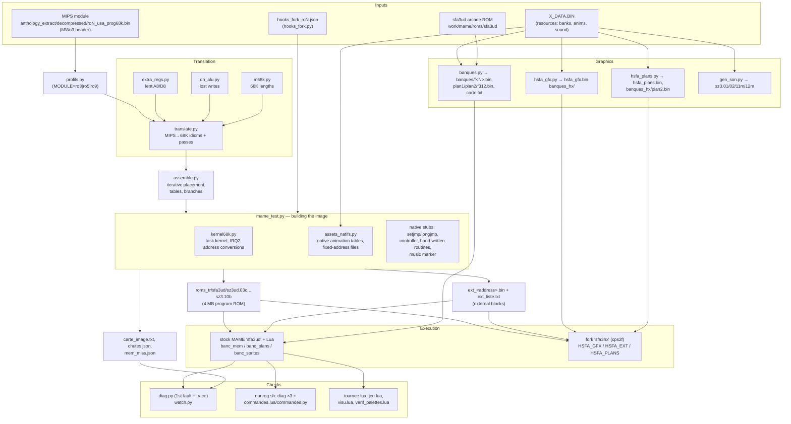

# Tool architecture — Hyper SFA / Anthology → CPS2

**Français : [OUTILS.fr.md](OUTILS.fr.md)**

> **Locations in the repository** (reorganisation of 2026-10-11): Python scripts = [`src/hsfa/`](../../src/hsfa/README.md),
> bench Lua scripts = `src/hsfa/mame/`, validation scripts = [`scripts/validation/`](../../scripts/validation/),
> fork patch = [`patches/mame-fork/`](../../patches/mame-fork/README.md). Shorter overview:
> [traducteur.md](traducteur.md).

> Reference documentation of the MIPS → 68000 retranslation tools for *Street Fighter Alpha Anthology* (PS2),
> of the MAME bench (Lua scripts) and of the MAME fork `sfa3hx`. Written on 2026-10-04 **from the code** (working copy
> `<workspace>/scripts/untranspile/`, Lua scripts of `<workspace>/work/mame/`, fork
> `<workspace>/mame-fork/mame/`), cross-checked against the journal `<workspace>/github/docs/journal/HANDOFF.md` (§1-§121).
>
> Conventions: "§N" = canonical series of the HANDOFF (see `INDEX-HANDOFF.md` §0); "va" = address in the file
> of the MIPS module (PS2 run-time address − `0x1F0000`); "cps2 mode" = universal memory recipe (§29, §32);
> `$xxxx` addresses are 68K, `0xxxxx` MIPS/PS2. The inconsistencies found are gathered in **§7** and
> flagged in place with ⚠.

## Contents

1. [Pipeline overview](#1-pipeline-overview)
2. [Sheets of the active Python scripts](#2-sheets-of-the-active-python-scripts)
3. [Historical or analysis scripts](#3-historical-or-analysis-scripts)
4. [Lua bench and MAME fork](#4-lua-bench-and-mame-fork)
5. [Data formats](#5-data-formats)
6. [Recipes](#6-recipes)
7. [Code ↔ journal inconsistencies and fragile points](#7-code--journal-inconsistencies-and-fragile-points)
8. [Where to look for… (index by topic)](#8-where-to-look-for-index-by-topic)

---

## 1. Pipeline overview

### 1.1 The principle

The Anthology holds SFA3 (`ro3`), Upper (`ro5`) and Hyper (`ro9`) as a **static recompilation
68000 → MIPS R5900**: each 68K register lives in a slot of the scratchpad (`0x70001100…`), and so do the flags.
The tools **recognise the recompiler's stereotyped idioms and re-emit the original 68000 instruction**
(it is not a decompiler), assemble the result, add a small 68K kernel that replaces the PS2 threads, and
produce a CPS2 program ROM that replaces the one of the Phoenix game `sfa3ud` in MAME. The SFA3 arcade ROM serves
as the answer key; Upper and Hyper have none.

### 1.2 Diagram

In one sentence: **`mame_test.py`** (entry point of the build) reads the module's profile, calls
**`assemble.assemble()`**, which calls **`translate.translate()`** on the whole 68K area of the module, places
the kernel and the stubs around the code, copies the module's data, and writes the ROM and its side files; the **bench** (stock
MAME + Lua) or the **fork** (`sfa3hx`) runs it; **`diag.py`** goes back from an exception to the faulty MIPS instruction
thanks to `carte_image.txt`; **`nonreg.sh`** replays the three diagnostics and the controls test.

### 1.3 The modules (profiles)

| Module | Game | File | Recompiled 68K code | End of code (header +12) | End of data (+24) | PS2 RAM | Working folder |
|---|---|---|---|---|---|---|---|
| `ro3` | SFA3 | `ro3_usa_prog68k.bin` | `0x22B00` | `0x393C40` | `0x88C700` | `0x900000` | `work/mame` |
| `ro5` | Upper | `ro5_usa_prog68k.bin` | `0x22B00` | `0x41ACC0` | `0x9A0180` | `0xA00000` | `work/mame_ro5` |
| `ro9` | Hyper | `ro9_usa_prog68k.bin` | `0x22DE0` | `0x3BF140` | `0xB67200` | `0xB80000` | `work/mame_ro9` |

(headers read again from disk; load base = `0x1F0000` for all three; RAM = `ram_hi_of()`, rounded up to the
multiple of `0x80000` above the end of the data, §30.) Between `0x20` and `0x22B00` there is **recompiled Z80**
(sound), never retranslated (§16).

### 1.4 Map of the produced 68K image (4 MB program ROM)

Derived from `mame_test.py` and `kernel68k.py` (ro3 values; ro5/ro9 given where they differ).

| 68K address | Contents | Produced by |
|---|---|---|
| `$000000-$0000FF` | vectors: SP = `PILE` (default `$664000`), PC = `$900`, level 2 (`$68`) = kernel IRQ2, all others → loop `$A00+2v` | `mame_test.main` |
| `$000400-$0007FF` | "convert An" routines for **PS2 data pointers** (`DPTR_FIX`, §63, binary search tree §104) | `kernel68k.build_conv` |
| `$000800` / `$000802` | `STUB_RTS` (fallback RTS of unconnected native calls) / RTE | `mame_test` |
| `$000810-$0008FF` | stubs of the native animation tables (one per site, "character" stub, dynamic stubs §108); **ro3**: then setjmp/longjmp and controller layer | `mame_test` + `assets_natifs` |
| `$000900-$000927` | boot: `LEA $FF8000,A5 ; JSR reset ; JSR init ; MOVE #$2000,SR ; JMP ordonnanceur` | `mame_test` |
| `$000940-$0009FF` | **ro5/ro9**: setjmp/longjmp and controller stubs | `mame_test` |
| `$000A00-$000A7F` | 63 `BRA.S *` loops (one per exception vector): signature of a fault for `diag.py` | `mame_test` |
| `$000B00-$000FFF` | **task kernel** (CREER, CEDER, FINIR, LANCER, scheduler, IRQ2) | `kernel68k.build` |
| `$001000-…` | **translated code** | `assemble.assemble` |
| `DATA_BASE` (4 KB aligned after the code) | module data, bytes of each word swapped (LE16 → BE16), up to `DATA_SPLIT` | `mame_test` |
| `ASSET` (after the data) | block of the decompressed "anim" files + character → pointer table | `assets_natifs.build` |
| `$3C0000-$3DFFFF` | **hash** table PS2 code address → 68K (16,384 × 8 B, §98); absent if `CODECONV_DICHO=1` | `kernel68k.build_hash` |
| `$3E0000-$3FEFFF` | sorted table (PS2 address, 68K address) of function starts (`CODEMAP`, §76) | `mame_test` |
| `$3FF000-` | "convert An" routines for **code addresses** (`CODECONV`, hash then binary search) | `kernel68k.build_code_conv` |

Outside the program ROM:

| Address | Contents |
|---|---|
| `$618000-$619FFF` | QSound shared memory (PS2 RAM + `0x60000`, §58) |
| `$660000-$6637FF` | stacks of the 16 tasks (`$660000 + (n+1)×$380`) |
| `$663800` / `$663880` / `$663884` / `$663888` | `SIDE` (saved stack, entry) / `SCHEDSP` / `CURSLOT` / `FLAG` (frame counter) |
| `$663890-$6638A7` | setjmp/longjmp buffers (3 buffers in all three modules) |
| `$6638F0` | `EXCMARK`: PC of an exception stub interrupted by the IRQ2 (read by `diag.py`, `tournee.lua`) |
| `$664000` | top of the scheduler / program stack |
| `$700000`, `$708000` | object memory (two pages) |
| `$900000-$92FFFF` | CPS2 video memory (PS2 RAM + `0x20000`) |
| `$A04000` / `$B04000` / `$C84000` | fixed-address sprite frame file: 289 (ro3) / 390 (ro5) / 547 (ro9) → `ext_*.bin` |
| `$B00000-$BFFFFF` | blocks of the MAX characters (`banques_max.py`, paused) |
| `DATA_EXT` | end of the data when the program exceeds 4 MB: `$C80000` (default, ro5: from `0x8E4AE0`, start of the block of character `$1F`, §126) / `$940000` (ro9) |
| `$F00000-` | `PORT_RAM`: variables of the port (under the PS2 RAM, then after the video at `+$80000`) |
| `$FF0000-$FFFFFF` | work RAM (PS2 RAM `0x00000-0x0FFFF`) |
| `$01xxxxxx` | **tagged** hardware addresses (`HW_TAG`, high byte `$01` ignored by the 24-bit bus) so that they are not converted again (§63) |

---

## 2. Sheets of the active Python scripts

Order: configuration → translation → assembly → build → checks → graphics/sound.
"Called by / calls" lists only the real links (imports or `subprocess`).

### 2.1 `profils.py` — per-module profile

- **Role**: gathers the constants specific to each module (entry points, addresses of the recompiler's
  helpers, controller sites, patched routines…). **Any missing or `None` value disables the
  corresponding feature** for that module.
- **Inputs**: `MODULE` (`ro3` default, `ro5`, `ro9`), `TRAVAIL` (replaces the working folder, for isolated
  trials).
- **Outputs**: `P` (module dictionary), `NOM`, `chemin()` (path of the MIPS module), `EXTRACT`.
- **Keys**: `fichier`, `va_reset`, `va_frame` (⚠ read but unused by `mame_test`), `va_init`, `irq2` or
  `irq2_dans` (address *inside* the VBL function, ro3), `sauve_regs` (register saving routines → RTS),
  `hooks` (JSON from `hooks_fork.py`), `manette` (site → `(offset, src, dst)`), `aides` (address → `movem_push`,
  `movem_pop`, `andi_ccr`, `abcd`), `be48` (A5 displacement of the animation pointer: `$BE48` ro3, `$C0BC` ro5/ro9),
  `musique` (start, continuation, index of the tick table, §103/§118), `objets_intro` (§103), `palettes` (engine table,
  §105/§119), `mains` (routines rewritten by hand, ro3 only), `data_ext` (ro9: `$940000`), `blocs`
  (§126, ro5: `(0x61A100, 32)` = table of the per-character data blocks; the cut of the data into an external block
  falls at the start of a block, because the code computes `table + 16-bit offset` at run time), `travail`, `sortie`.
- **Journal**: §108 (creation), §114, §118, §119, §121 (ro9).
- **Called by**: `mame_test`, `diag`, `hsfa_gfx`, `hsfa_plans`.

### 2.2 `mips.py` — MIPS R5900 decoder

- **Role**: decoding by bit fields, without capstone. Class `Ins` (`va, w, op, rs, rt, rd, sa, fn, imm, simm,
  tgt, m`), generator `decode(buf, start, end)`, `code_bounds(buf)`.
- **Constants**: `CODE0 = 0x22B00` (68K start, ⚠ wrong for ro9, which starts at `0x22DE0`, see §7), `CODE1 =
  0x393C40` (ro3 end), `Z80_0/Z80_1`.
- **Journal**: §4, §16.
- **Called by**: almost every script.

### 2.3 `m68k.py` — 68000 instruction lengths

- **Role**: computes the size of a 68000 instruction and the nature of its extension words (`imm` / `disp` /
  `abs`), without disassembling. `ea_words`, `ea_kind`, `decode_one(w, i, n)`, `walk(buf, start, end)`.
- **Used by the build**: the passes of `translate.py` (`_shorten`, `_rewrite_ea`, `merge_postinc`,
  `byte_streams*`) use it to find instruction boundaries in the output.
- **Called by**: `translate`, `verify`, `chain`, `propagate`, `reach`, `opclass`…

### 2.4 `translate.py` — the translator (3,373 lines)

**Role**: `translate(buf, start, end)` returns `(out, unknown)`, where `out` is a list of triples
`(va_mips, mnemonic, [68K words])`. A light symbolic simulation tracks what each MIPS register holds;
when a complete pattern is recognised, the 68000 instruction is emitted. Elements with 0 words serve as labels.

**⚠ Textual contract with `assemble.py`**: the assembler reads back **markers in the mnemonic** — `(cible xxxx)`
(branch), `[mips xxxx]` / `[cible xxxx` (external call), `T_xxxxxx` (PC-relative table), `CODE_xxxxxxx` and
`_ECH` (code pointer, swapped long), `prete]` (opening of an A8 zone). Changing a mnemonic format can break
assembly without any visible error.

**Inputs**: the module (bytes), `[start, end)` in va. **Environment variables**: `MEMMODE` (`hote` default;
`cps2` forced by `mame_test`; `type` experimental), `EXTRA_REGS` (1), `A8_HOME` (`87e0`, `none` = old
behaviour), `D8_HOME` (`87f0`), `LONG_POSTINC` (1), `DROP_SR` (1), `BYTE_PRE` (1), `DN_ALU` (1; also cuts
`mem_fix`), `MASQ_OK` (whitelist of 32-bit masks, diagnostic), `TYPE_REGS` (`5,6`, `type` mode), `AUDIT_MEM`
(1 → `MEM_MISS`), `DBG_VA`, `DBG_RANGE` (traces).
Added in §126 (all 1 by default, `=0` restores the old behaviour): `FTC_AVANT` (test returned to the caller placed before
the restores of a shared epilogue), `TBL_TST` (table value only tested), `EXG_PILE` (An↔Am exchange
through a temporary of the MIPS stack), `SW_X4` (switch with an index already ×4), `LUI_IMM` / `CONST_OP` (constants `lui`
alone, `lui+ori/addiu`, `sw zero` / `lui` stored on the stack, as exact comparison operands). Added in §128: `EXT_MEM`
(signed read `lb`/`lh` stored wider in a D register → `MOVE` + `EXT`, counter `EXT_MEM_N`).

**Globals set by `mame_test` before the call**: `AIDES_RECOMP`, `DATA_EXT`, `HW_TAG`, `DPTR_FIX`, `DATA_BASE`,
`DATA_SPLIT`, `CODE_CONV`. **Globals read afterwards by `mame_test`** (one-element counters): `LONG_POSTINC`,
`VRAM_SHIFT`, `IDX_X4`, `LONG_SR`, `ABS_AN`, `ADDA_MEM`, `DN_ALU`, `MEM_FIX`, `BYTE_ADDA`, `BYTE_PRE`,
`FTC_AVANT_N`, `TBL_TST_N`, `EXG_PILE_N`, `SW_X4_N`, `LUI_IMM_N`, lists `CHUTES`, `MEM_MISS`, **`EXACT_MISS`** (§126:
"exact flags" blocks recognised but with an unknown operand → comparison lost; written by `mame_test`
to `<travail>/audit_exacts.txt`; ro3 0, ro5 10 remaining); `_CODE_STARTS['set']` (function starts), `TABLES` (switch tables read),
`ZONE_OPEN` (read by `assemble`).

#### 2.4.1 Model of the register bank (correct version, §11, §53)

| Slot `0x7000xxxx` | 68K register | Note |
|---|---|---|
| `0x1100-0x111C` | A0-A7 | A7 = MIPS stack of the port: writes absorbed (§59) |
| `0x1120` | **A8** (extra register) | lent to a free An or "home" `$87E0(A5)` |
| `0x1124-0x1140` | D0-D7 | |
| `0x1144` | **D8** | lent to a free Dn or home `$87F0(A5)` |
| `0x114C` | private stack | `private_stack()` → 68K stack (§72) |
| `0x1150` | RES (Z, N) | `RES_SLOT` |
| `0x1154` | X | `X_SLOT` |
| `0x1158` | **C (carry)** | constant named `NFLG_SLOT` with the comment "signe (flag N)" ⚠ misleading (§7) |

`slot_name(off)` → `('A'|'D', n)`; `ACTIVE_EXTRA` redirects A8/D8 to the register lent in the current zone;
`an_slots(n)` = slots that designate An (its own + A8 if lent on An).

#### 2.4.2 Address conversion (cps2 mode)

- `mconv(disp, size, an)`: byte → displacement XOR 1 (cps2 recipe); `type` mode: `typed_rule.predict_typed`.
- `addr_to_68k(v)` / `_addr_to_68k(v)`: PS2 address → 68K. Order: hardware registers `HWREG` (port
  variables → real CPS-A/B registers, inputs `$804000…`, §57/§62/§80); `ADDRMAP` (RAM → `$FF0000`, QSound →
  `$618000`, objects → `$700000/$708000`, video → `$900000`); end of data → `DATA_EXT` (if `DATA_SPLIT`);
  data → `DATA_BASE`; port variables → `PORT_RAM`. `HW_TAG` adds `$01000000` to hardware addresses.
- `abs_addr(host, size)`: absolute address + XOR 1 for a byte, except `BYTE_EXACT` (input ports).
- `WIDEREG`: CPS-A base registers widened to 32 bits by the port. `INPUT_INV`: empty since §80.
- `set_module_bounds(buf)` reads `CODE_END_RT` / `DATA_END_RT` in the header; `code_end_translate(buf)` extends
  up to the `jr ra` that follows the announced end (§76); `ram_hi_of(buf)`.
- `mips_to_68k(va)` + `_load_map()`: piecewise interpolation on `map_chain2.json` / `map_ro3_sfa3.json`
  (legacy of the "map" phase, R§5/C1-C5). In the build, the value is **not used**: `assemble`
  reads the target back from `[mips xxxx]` and resolves it itself.

#### 2.4.3 Pre-passes on the MIPS stream (before the loop)

| Function | What it does | § |
|---|---|---|
| `unaligned_pairs(L)` | `swl/swr` (`lwl/lwr`) pairs at an even displacement not a multiple of 4 → synthetic `sw`/`lw` | §67 |
| `slot_ori(L)` | slot addressed by `ori rX,rL,off` (rL = `lui 0x7000`) → usual form | §78 |
| `hautes_moities(L)` | `lh/sh` access to the high half of a Dn → pseudo-instruction `swapd` (emitted as `SWAP Dn`) | §82 |
| `private_stack(L)` | pushes/pops on the private stack `0x114C` → `MOVE.L Rn,-(SP)` / `(SP)+` | §72, §77 |
| `extra_zones(buf)` → `extra_regs.plan` | zones where A8/D8 receive a lent register | §53-§54, §80 |
| `empty_funcs(buf)` | functions reduced to `jr ra` (tail call to them = shared `RTS`) | §47 |
| `_CODE_STARTS` | function starts by prologue `addiu sp,-N ; sd ra` (targets of code pointers) | §76 |

#### 2.4.4 Symbolic tracking (main loop)

Dictionaries updated at each instruction: `st` (MIPS register → `Sym(kind, val, sz)`), `lui`, `memread`
(`d16(An)` read), `absread` (absolute read), `idxread` / `idxbig` (indexed read `d8` / `d16`), `ldsize`,
`spill` (temporaries stored on the MIPS stack, tracked through), `REG68`. `Sym` kinds: `imm`, `const`, `an`
(An + displacement), `an_d`, `reg68`, `arithi`, `sub`, `zx`, `memadd`, `memarith`, `memlogic`, `dmem`, `tblidx`,
`tblent`, `dynbit`, `neg`, `shift`, `scaled`, `flag`. **Invalidation**: `dest_reg(ins)` erases the information of the
destination, except propagation through sign-extension shifts (`_SHIFT_KEEP`); the sources are
**snapshotted before** the invalidation (`SM`, `SAB`, `SL`, `SI`) for the `andi v1,v1,…` case.

#### 2.4.5 Families of recognitions (in `translate()` and its helpers)

**Flags and branches**

- Deferred test `pend`: the write of RES (`sw RES`) sets a pending test (`tst_mem`, `tst_dn`, `tst_abs`,
  `tst_idx`, `cmp`, `btst`, `btst_dn`, `btst_dyn`) that the next Bcc materialises (`TST`/`CMP`/`BTST` + Bcc);
  dropped if the emitted operation already set the flags (`flags_set`, `moved`, `arith_written`, `last_sub`).
- Mappings `BCC_OF` (Z/C × beq/bne/bltz/bgez/bgtz/blez) and `SIGNED_OF` (N⊕V → BLT/BGE/BGT/BLE, §20).
- Internal blocks of the recompiler absorbed: `carry_block` (computation of C by `sltu`), `exact_flags` ("exact
  flags" variant, §20), `full_flags_block` (recent recompiler of Upper/Hyper, §52), `derives_from` (§75).
- `flags_to_caller`: test returned to the caller before `RTS` or before a `BRA` to the epilogue (§66, §80, §87, §93,
  §114). `flags_read_first`.
- Sign of a value modified in place → `BPL/BMI` (§73); the recompiler's "DBRA" = `SUBQ ; BPL` (≥ 0, §74).
- `beq zero,zero` = `BRA` (§63); `bne +2 ; j far` merged back by the assembler (§37).
- Native result `jal f ; beq/bne v0,zero`: `v0` assumed to be zero (§65).
- Deferred bit test whose byte is rewritten before the Bcc: flags saved (`MOVE SR` … `MOVE (SP)+,CCR`,
  counter `N_BTST_CONFLIT`, §80).

**Calls and returns**

- `jal` / `jalr` to a constant → `JSR/JMP $x.L [mips x]`; tail call by `tail_return` (immediate return) or
  `tail_branch` (jump to the common epilogue) → `JMP` (§6, §9); tail call to an empty function → `RTS` (§47).
- Recompiler helpers (`AIDES_RECOMP`, `aide_recomp`): `MOVEM` with mask, `ANDI #,CCR`, `ABCD` byte by byte
  (§83).
- `lw r,An ; jalr r` → `JSR (An)` / `JMP (An)` preceded by `JSR CODE_CONV[n]` (PS2 code addresses converted on
  use, §70, §76).
- Capcom state switch: `jalr` on a table entry (`tblent`) → `MOVE.W T(PC,Dn.W),Dm ; JMP/JSR T(PC,Dm.W)`,
  table read by `read_jump_table` and bounded by `data_refs` (§15); raw ×4 index doubled (§102).
- `jr ra` → `RTS`, absorbed if it closes a tail call, kept if it is a branch target
  (`epilogue_is_target`, §64).

**Address registers**

- `movea_fixup`: the "+0x900000" conversion added by the recompiler after a `MOVEA.W` is absorbed (§10).
- `MOVEA.W An,Am` (§86), `MOVEA.L abs.L,An` (§106, `ABS_AN`), `ADDA.W d(An),Am` (`adda_mem`, §107, `ADDA_MEM`),
  `MOVEA.L T(PC,Dk.W),Am` on a pointer table (§67) and raw ×4 index (§112, `IDX_X4`), `ADDA.W T(PC,Dk.W)` (§83),
  `LEA T(PC,Dn.W),Am` (`lea_table_index`, §65), `EXG` (§42, §80), `movea_l_mem` (swapped long), the port's
  `(An+3)&~3` realignment kept (§63), resync of the MIPS registers that keep the old value of An.

**Data, arithmetic, logic**

- `MOVE` memory↔register↔memory (`enc_move_*`), `MOVEQ` (`enc_imm_dn`), `CLR` (`enc_clr_an`), `ADDQ/SUBQ/ADDI`
  (`enc_addimm_dn`), register-register arithmetic (`enc_arith`), `Dn OP memory` and `memory OP= Dn`
  (`enc_op_mem_dn`, `enc_op_dn_mem`), in-place operations (`enc_addsub_mem`, `enc_logic_mem` → `BSET/BCLR/BCHG` or
  `ORI/ANDI/EORI`), in-place `SUBI` (§90), `SUB.x Dk,d(An)` (§78).
- Shifts (`enc_shift_dn`, `LSL` preferred), rotations (`rot_of` → `ROR/ROL`), `NOT` (`nor`, §80), `NEG`,
  in-place sign extension `EXT.W/EXT.L` (`sign_ext_inplace`, §67), `ADDX` (`addx_at`, §77).
- Swapped bytes and halves: `is_swap`, `swap_or` (SWAP assembled for a natural store, §83), `bswap32_or`
  (long stored byte by byte, §90), `bswap16_mem` / `bswap16_of` (byte-swapped word, §92, §100), `ROR.W #8`
  to memory (§77).
- Constants: `lui` alone (`lui_only`, `ADDI.L #$16000000`, §85), 32-bit masks `lui ; ori` (`_masque_ok`, §83),
  odd constant never taken for an address (§101), address constant in `CMPI.L` converted (§88), immediate
  split into two `addiu` (§80).
- Static bit tests (`enc_btst_an`, `btst_target`: right byte of a word) and dynamic ones (`enc_dynbit`, §80).
- Indexed accesses `d8(An,Dn)` (`idx_ext`); `d16(An,Dn)` out of range → exact address computed (`idxbig_seq`, §78);
  absolute read propagated through sign extension (QSound `$61801F`, §118).

**cps2 recipe (bytes XOR 1, longs with swapped halves)**

- Long in memory: `SWAP` around register↔memory `MOVE.L`; `CMPI.L` against the real value (`enc_cmp`,
  §80); in-place operation on a long (`inplace_long`, §80, §104); `MOVE.L An,d(Am)` (§67, §80).
- Byte read as a half-word then compared as a byte → XOR 1 (`enc_cmp._fixb`, §69/§70).
- Write of a code pointer constant: `MOVE.L #CODE_x_ECH` (swapped PS2 value, converted on use).

**Catch-ups (`dn_alu.py`)**: when a write to a D or A slot has produced nothing, `dn_alu()` / `a_alu()` try
extra forms; otherwise the drop is recorded in `CHUTES` (§107, counter "register writes
dropped").

#### 2.4.6 Post-passes (on the `out` list, in this order)

| Pass | Effect | Condition | § |
|---|---|---|---|
| `dn_alu.mem_fix` | inserts the memory writes left without a trace | `DN_ALU≠0` | §107 |
| `$0000(A` → `(A` + `zero_disp_short` / `_shorten` | zero `d16(An)` → `(An)` | always | §36 |
| `merge_postinc` | `ADDQ #s,An` + access `-s(An)` → `(An)+`; `SUBQ` + `(An)` → `-(An)` | always | §36 |
| `merge_long_postinc` | long read in two halves by post-increment → `MOVE.L (An)+,Dm` | cps2, `LONG_POSTINC≠0` | §103 |
| `vram_shift_const` | video address formed by a shift → converted constant | cps2 | §110 |
| `drop_dead_sr` | removes the SR save of an `inplace_long` if the next instruction overwrites NZVC | cps2, `DROP_SR≠0` | §104 |
| `byte_streams` | byte streams `(An)+`: exact address at run time | cps2 | §65 |
| `byte_streams_pre` | decreasing byte stream `-(An)` | cps2, `BYTE_PRE≠0` | §121 |
| `byte_index_exact` | indexed byte `d8(An,Xn)` at an odd index: exact address | cps2 | §66 |
| `byte_after_adda` | byte through an An of unknown parity after `ADDA` | cps2 | §97 |
| `dptr_fix` | `MOVEA.L <mémoire|Dn>,An` + `JSR CONV_An` (PS2 data pointers) | `DPTR_FIX` not empty | §63 |
| `MEM_MISS` audit | stores without a trace in the output | `AUDIT_MEM=1` | §107 |

#### 2.4.7 Other

- Encoders: `enc_btst_an`, `enc_clr_an`, `enc_cmp`, `enc_move_mem_mem`, `enc_move_reg_dn`, `enc_move_pcidx`,
  `enc_sub_dn`, `enc_tst_an/dn`, `enc_jsr_abs`, `enc_jmp_abs`, `enc_movea_*`, `enc_lea_*`, `enc_adda_dn`,
  `enc_addq_an`, `enc_immop_dn`, `abs_words`, `swap32`, `bs32`.
- `type` mode (`mconv`, `rev_field`, `type_const`, `typed_rule`, `layout_rule.access_stats`): "typed per
  field" model of §44, **never generalised**; not used by the build.
- `__main__`: translates the anchor `0x201FA8` and compares it to the 68K `0x9350` of `work/cps2/sfa3_prog.bin`.
- **Called by**: `assemble`, `mame_test`, `census`, `natmiss`, `verify`, and most of the analysis scripts.
  **Calls**: `mips`, `m68k`, `extra_regs`, `dn_alu`, (`type` mode) `layout_rule`, `typed_rule`.

### 2.5 `extra_regs.py` — lent A8/D8 registers

- **Role**: A8 (`0x1120`) and D8 (`0x1144`) do not exist on the 68000. `plan(buf)` splits each use into **live
  ranges** and returns, per function, zones `(kind, 68K register, slot, start, end)` translated as
  `MOVE.L Rk,-(SP)` … `MOVE.L (SP)+,Rk` (or through the homes A8 `$87E0(A5)` / D8 `$87F0(A5)`). Conditions: no
  call in the zone, single entry/exit, free register (in the function, or at least in the zone: saved /
  restored).
- **Functions**: `analyse(buf)` (old method by closure of the call graph, ⚠ described by the module's docstring
  but **not used** by the build); `plan(buf)` (used through `translate.extra_zones`).
- **Mechanisms of `plan`**: new live range at each "fresh" write; "if / else" merge
  (`MERGE_IFELSE`, §114, counter `MERGED`); split of A8 around calls (home, §80); extension of the zone
  to loop back-edges and to the last use of the derived MIPS registers (§66, §73); early close
  `EARLY_CLOSE` (§80); loop back-edge coming from after the zone (`BACK_AFTER`, §121, counter `BACK_AFTER_N`).
- **Variables**: `A8_HOME` (`none` disables the home plan), `MERGE_IFELSE`, `BACK_AFTER`, `LOOP_EXT` (reach of the
  loop back-edge after the last access, `0x100`; `0x40` before §126), `PARTIAL_LIVE` (0; trial: `sb`/`sh` do not
  cut a live range), `LATERAL` (1, §130: side exits accepted, rewritten by `translate`), `DBG_PLAN=lo-hi`, `MODULE` (`__main__`).
- **Standalone use**: `MODULE=ro3 python3 extra_regs.py plan` (statistics of the zones and refusals).
- **Journal**: §53, §54, §65, §66, §72-§73, §80, §114, §121.

### 2.6 `dn_alu.py` — lost writes (§107 audit)

- **Role**: MIPS → 68K forms not recognised elsewhere, called when a register write has emitted nothing.
- **Functions**:
  - `dn_alu(L, i, n, size, tbl_ok)`: `ADDI` (chain of `addiu`), `ANDI.L` (`dsll32/dsrl32` pair), `MULS.W #k`
    (`x*5 << s`), variable shifts `LSL/ASR/LSR Dm,Dn`, `ADD.x Dn,Dn`, `ADDI/ANDI/ORI #c`, `OP.x T(PC,Dk),Dn`.
  - `a_alu(L, i, am, bswap16_of)`: `SUBA.L Dk,Am`, `LEA d16(An),Am ; ADDA Dk,Am`, `ADDA.L` of a byte-swapped
    word through D0.
  - `mem_fix(L, out, inplace_long, abs_addr, addr_to_68k)`: inserts lost memory writes (long in place,
    `ANDI.W #c,abs.L`, signed byte from a table to a field, unaligned long `swr/swl`).
  - helpers: `_prod` (producer of a register), `_dest`, `_orig` (goes back through sign extensions and masks),
    `_slot_d`, `_slot_a`, `_const`, `_imm`.
- **Variable**: `DN_ALU=0` cuts `dn_alu`, `a_alu` **and** `mem_fix`.
- **Called by**: `translate`.

### 2.7 `assemble.py` — 68000 assembler with iterative placement

- **Role**: `assemble(buf, start, end, base, external, native)` translates `[start, end)` then places and encodes. Returns
  `(its, words, unresolved)`: elements (`Item`: `va, mn, ws, kind, tgt, cond, choice, off, host…`), 68K words,
  number of unresolved references.
- **Steps**:
  1. `classify(items, buf)`: kinds `fixed`, `bcc`, `call`, `jump`, `switch` (JMP/JSR `T(PC,Dn)`), `tblref`
     (`MOVE.W T(PC,Dn),Dm`), `dtab` (PC-relative data table), `codeptr`; `Bcc +2 ; JMP far` merged back into
     B(inverse cond) far, unless the jump is itself a target (§91); choice of the host of each table (after the
     JMP, after the next break, or `skip` = table jumped over by a BRA).
  2. Relaxation (30 rounds max): short branches → long → `far` (`B!cc.S +6 ; JMP abs.L`, §70/§71); calls
     `BSR.S/BSR.W/JSR.L`, jumps `nothing/BRA.S/BRA.W/JMP.L` (nothing = the target is the next instruction); table
     entries out of 16-bit range → `JMP abs.L` trampolines after the table (`FAR_ENT`, §93/§94); data tables
     hosted out of d8 range → `inline`.
  3. Emission: one **copy of the table per switch** (§63), `BRA.S` tables (`BRAS_TABLES`), data tables in
     absolute form (`DTAB=abs`: `LEA données.L,An`, byte at the exact address + XOR 1 at run time, §63/§80),
     code pointers (PS2 value if `CODE_CONV`, swapped if `_ECH`), `DPTR_FIX` conversion after a `MOVEA.L`
     read from a pointer table (`dtab_fix`).
- **Helpers**: `table_bytes`, `table_size`, `dtab_fix`, `base_size`, `size`, `dtab_start`.
- **Labels**: a MIPS target designates the **first** 68K instruction emitted from it; exception: loop
  back-edge inside an A8 zone → after the opening (`translate.ZONE_OPEN`, §80).
- **Variable**: `DTAB` (`abs` default). **Globals**: `BRAS_TABLES`, `FAR_ENT` (read by `mame_test` for the
  report).
- **Journal**: §37, §55, §63, §64, §70-§71, §75, §80, §91, §93-§94.
- **Called by**: `mame_test`, `link`, `build_rom`, `e2e`, `diverge`… **Calls**: `translate`.

### 2.8 `kernel68k.py` — task kernel and address conversions

- **Role**: 68000 machine code generator (mini-assembler `Asm`: `L`, `emit`, `bra`, `jsr`, `jmp`, `done`).
- **`build(org, vbl_addr, n_slots=16, code_conv)`**: cooperative kernel modelled on Capcom's (ROM
  `$1110…`), on the task table **of the port** (`A5+$8184`, 16 × `$20`, state = byte +1, current `A5+$8388`).
  Entry points returned: `creer` (CreateThread, D0 = slot×$20, A0 = entry), `ceder` (SleepThread),
  `finir` (ExitThread / ExitDeleteThread), `lancer`, `ordo` (foreground scheduler, waits for `FLAG`), `irq2`
  (marks `EXCMARK` if an exception stub is interrupted, `JSR` to the ported VBL, `FLAG+1`, `RTE`).
- **`build_conv(org, ranges)`**: "convert An" routines for **PS2 data pointers** (ranges
  `(start, end, addend)`; flags and registers preserved; binary search tree, §104).
- **`build_code_conv(org, table, n, lo, hi, hash_addr)`**: "convert An" for **PS2 code addresses** (hash with
  linear probing if `hash_addr`, otherwise binary search; §76, §98). `code_hash(k) = ((k>>2) ^ (k>>8)) & $3FFF`;
  `build_hash(pairs)`.
- **`disasm(code, org)`**: capstone disassembly (only in `__main__`; ⚠ the docstring says "vérifié par
  désassemblage capstone" (checked by capstone disassembly), it is not automatic).
- **Journal**: §60-§61, §63, §76, §80, §98, §104.
- **Called by**: `mame_test`.

### 2.9 `assets_natifs.py` — resources loaded by the native code

- **Role**: the port moved out of the ROM some animation tables (intro, one per character) loaded by native
  functions at a fixed address (`LOAD_BASE`, pointer stored at `$BE48(A5)` / `$C0BC(A5)`). These "anim" files
  (MWo3/LZSS) are decompressed and stored in a block with virtual base `VBASE` (pointers relocated), mapped by the
  pointer conversion; the native calls become 68K stubs. Also handles the **fixed-address files**
  (`FIXES`: 289 → `$A04000` ro3, 390 → `$B04000` ro5, 547 → `$C84000` ro9).
- **Functions**: `fichier(n)` (cache `work/cps2/anims/f<N>.bin`, otherwise `X_DATA.BIN` through `XDATA`; writes the cache),
  `tables(buf)` (site index, character index), `build(buf)` → `(blob, {file: virtual address})`, `swapped(v)`.
- **Per-module constants**: `LOAD_BASE`, `LOAD_SITE` (ro5: intro loaded `0x800` higher), `VBASE`, `T_SITE`,
  `T_PERSO`, `N_PERSO`, `NATIF_SITE`, `NATIF_PERSO`, `SITES`, `SITES_DYN` (ro5, index chosen at run time),
  `PERSO_OFS`, `N_SITE`. ro9: no native loader (empty block).
- **Variables**: `MODULE`, `XDATA` (⚠ mandatory if the cache is missing: `os.environ["XDATA"]`, no default),
  `ANIM_CACHE` (cache in write mode).
- **Journal**: §75, §106, §108, §121.
- **Called by**: `mame_test`, `banques.carte`. **Calls**: `mwo3_codec` (in `anthology_extract`), `census`
  (`__main__` only).

### 2.10 `hooks_fork.py` (+ `natmiss.py`, `census.py`) — native connection points

- **Role**: lists the calls of the recompiled game to native code (C functions of the module or PS2 engine) →
  `hooks_fork_<module>.json`. `mame_test` extracts from it the "module native" functions (then filters them with
  `native_at`) so as not to translate them.
- **`setjmp_sites(buf)`**: `jal` sites to `setjmp 0x119F48` / `longjmp 0x119FA0` with their constant buffer (§75).
- **Active dependencies**: `natmiss.native(f)` ("native function" criterion: no `lui 0x7000` access, `sq/lq`,
  stack frames > 16 B, relays excluded) and `census.RO3` (path of the module according to `MODULE`, despite its name).
- **Use**: `MODULE=ro3 python3 hooks_fork.py` (to run again only if the module or the criterion changes).
- **Journal**: §55, §75, §101.

### 2.11 `mame_test.py` — building the image (entry point)

- **Role**: produces the translated program ROM of a module and all its side files (§59 onwards).
- **Use**: `[MODULE=ro5] XDATA=… python3 mame_test.py [va_reset] [va_irq2] [va_frame]` (profile defaults).
- **Inputs**: MIPS module (`profils.chemin()`), `hooks_fork_<module>.json`, `X_DATA.BIN` (or cache
  `work/cps2/anims`), ROM of `work/mame/roms/sfa3ud` (symbolic links), for MAX: `~/.cache/sfa3max/converti/`.
- **Outputs** (in `P['travail']`): `<sortie>/sfa3ud/sz3ud.03c … sz3.10b` (8 × 512 KB, words swapped) + links to
  the other files of `sfa3ud`; `carte_image.txt`; `ext_<adresse>.bin` (end of the data if cut, fixed-address
  files); `ext_liste.txt`; `chutes.json`; `mem_miss.json` (if `AUDIT_MEM=1`). Report on standard
  output (counters of the passes, "écritures de registre tombées sans traduction" (register writes dropped without translation) = regression indicator,
  §107).
- **Steps of `main()`**:
  1. profile → `T.AIDES_RECOMP`, `T.DATA_EXT`; `MEMMODE=cps2` forced before importing `translate`.
  2. keys of the code address conversion: `jal` targets, data longs that point to a prologue,
     `_CODE_STARTS`; hash table `$3C0000` (`CODECONV_DICHO=1` → binary search only); `T.CODE_CONV`.
  3. kernel (`K.build`): PS2 system calls → `creer/ceder/finir`; any other external call → `STUB_RTS`.
  4. native resources (`assets_natifs`): site and character stubs.
  5. native functions of the module (`hooks` filtered by `native_at`, §101).
  6. `DPTR_FIX` (`build_conv` at `$400`); assembly; **stabilisation loop** of `DATA_BASE` (the size of the
     code depends on it) and of `DATA_SPLIT` (data cut under the ceiling, end in an external block, §108).
  7. IRQ2: `irq2` of the profile, otherwise the function containing `irq2_dans`.
  8. vectors, exception loops, boot `$900`, kernel `$B00`, code `$1000`.
  9. `sauve_regs` → RTS; **routines rewritten by hand** if `mains` (`MAINS=n` limits their number):
     fill `0x898E0`, binary→BCD `0x89A10`, tile copies `0x10DD50`/`0x10E200`, per-line scrolling
     `0xF72D8` (§103-§104); arcade **music marker** (§103, §118).
  10. data (bytes swapped); `MAX_DEMO` (redirection of Ryu's frames), `MAX_PAL`/`MAX_PAL_ID` (MAX
      palettes, §99/§105/§119); `objets_intro` table (parameter bytes swapped, §103).
  11. animation block, character/dynamic stubs, hash table + `CODEMAP` + `CODECONV`, setjmp/longjmp stubs
      (`patch_call`), controller layer (§80), fixed-address files, `ext_liste.txt`.
- **Functions**: `patch_call(img, it, a)` (redirects an emitted `JSR abs.L`/`BSR.W`), `native_at(buf, t)` (native
  criterion recomputed on the real range of the function, §101), `main()`.
- **Variables**: `MODULE`, `TRAVAIL`, `XDATA`, `VA_INIT`, `PILE` (`664000`), `DPTR` (`runtime`), `CODECONV_DICHO`,
  `MAINS`, `MAX_DEMO`, `MAX_PAL`, `MAX_PAL_ID` (⚠ never for a reference build) + all those of
  `translate`, `extra_regs`, `assemble`.
- **Journal**: §59, §61, §63, §75-§76, §80, §98-§99, §101, §103-§108, §118-§119, §121.
- **Called by**: `diag.py` (without `--nobuild`). **Calls**: `translate`, `assemble`, `kernel68k`,
  `assets_natifs`, `hooks_fork`, `extra_regs`, `profils`, `mips`.

### 2.12 `diag.py` — diagnostic loop

- **Role**: (re)builds the image, runs it in MAME, detects the **first exception** (PC in `$A00-$A80`, or
  `EXCMARK` set by the IRQ2, or PC ≥ `$400000` = code 99), runs again with an instruction-by-instruction **trace**
  around the faulty frame and prints the last N instructions with their **MIPS va** and the translated mnemonic
  (`carte_image.txt`).
- **Use**: `[MODULE=…] [MAXF=1800] [INPUTS="…"] python3 diag.py [N=60] [--nobuild]`.
- **Inputs / outputs**: ROM `P['travail']/P['sortie']`, `carte_image.txt`; temporary files `_diag.lua`,
  `_diag.txt`, `_diag.tr` in the working folder. Exit code = exception number (0 if none).
- **Functions**: `mame(script, debug, timeout)` (runs `mame sfa3ud` with `banc_mem.lua` + `LUA_INPUTS` + the
  script), `carte()`, `lookup(rows, keys, a)`, `main()`. Lua templates: `LUA_DETECT`, `LUA_TRACE`, `LUA_INPUTS`
  (`INPUTS` format identical to `jeu.lua`).
- **Variables**: `MODULE`, `MAXF`, `INPUTS`; sets `BANC_DIR`.
- ⚠ Loads only `banc_mem.lua` (neither planes nor sprites): enough for exceptions, not for the picture. Uses the
  stock `mame` binary, not the fork.
- **Journal**: §63, §80, §114.
- **Called by**: `nonreg.sh`, `watch.py` (functions `carte`, `lookup`, `W`).

### 2.13 `watch.py` — watchpoint

- **Role**: sets a `wpset` on an address and lists the writes (frame, 68K PC → MIPS va, value).
- **Use**: `watch.py ADRESSE_HEX [taille=2] [images=200] [max_lignes=40]`.
- ⚠ ROM hard-coded to `W/roms_tr` (does not use `P['sortie']`: wrong for ro5/ro9).
- **Journal**: §63.

### 2.14 `nonreg.sh` — non-regression (ro3 only)

- **Role**: after each translator fix and a rebuild: (1) 20,000 frames without input,
  (2) 20,000 frames with coin / Start / button, (3) 60,000 frames of an offensive game (three `diag.py --nobuild`),
  (4) controls test `commandes.lua` compared with `cmd_ref.txt` by `commandes.py`.
- **Expected**: "aucune exception" (no exception) ×3, "42 actions, 0 différentes" (0 different), 5,359 ticks in 4,019 frames (133.3%).
- ⚠ Hard-coded ro3 paths (`work/mame`, `roms_tr`), no `MODULE`. Duration: up to ~2 h.
- **Journal**: §110, §117.

### 2.14 ter `balayage_fins.sh` — sweep of the endings (§131)

- `balayage_fins.sh ro3|ro5 [persos]`: one Arcade game per character up to its ending; `work/balayages/<module>_<date>/res.txt`
  (`fin=finie` expected; ro3: `captures` = `ref` ±1). Variables `P` (parallel runs), `NF`.

### 2.14 quater `_prof_adapt.lua` + `prof_an.py` — profile of the adapters (§138)

- `mame/_prof_tour.lua` = `tournee.lua` + `_prof_adapt.lua`: opcode words read by ADDRESS, fight frames
  (`$FF800C = 6`) only, from frame `K0`; output `POUT` ("address count").
- `prof_an.py <travail> <profil> <fin_code_hex> [attente_lo-hi]`: disassembles the translated ROM (`unidasm`), removes the
  wait loop and classifies the work (conversions `$400`/`$3FF000`, `SWAP`, `MOVE SR/CCR`, stack, XOR 1 bytes,
  lent registers, useful code); hot zones per 256 B.

### 2.14 bis `nonreg_ro5.sh` — Upper non-regression (§126)

- **Role**: after a rebuild of ro5: 20,000 attract-mode frames (`MODULE=ro5 diag.py --nobuild`), then three
  complete Arcade games on the fork (`cps2f sfa3hx` + `tournee.lua`) in parallel: Ryu `00`, Chun-Li `04`
  (fight against Juli and Juni), Akuma `02` (Vega on the fence).
- **Expected**: "aucune exception" (no exception), then `FIN fin=finie` for each character. Duration ~15 min.
- **Variables**: `NR5_PERSOS` (list), `NR5_NF` (frames per game, 70,000); `HSFA_SON` is passed on (hybrid sound, §127).
- `tournee.lua`: `VS=1` = two-player VERSUS (§128); multiple opponents (Juli and Juni, §126).

### 2.15 `commandes.py` — comparison of the controls test

- **Role**: reads two logs of `commandes.lua` (`A` actions, `F` states per frame, `C` game ticks) and compares,
  action by action, the sequence of the player's distinct states (one-frame states ignored: sampling) and the
  X/Y movement; prints the ticks/frames ratio.
- **Use**: `commandes.py ref.txt tr.txt` (reference `work/mame/cmd_ref.txt`, produced with `REF=1`, **do not
  overwrite it**).
- **Journal**: §93.

### 2.16 `banques.py` — sprite banks and planes → CPS2 codes (stock MAME bench)

- **Role**: for each tile of an Anthology bank (X_DATA container), finds **by its contents** the global
  code in the SFA3 graphics ROM; chooses, among the codes with the same contents, the one that continues the sequence
  (multi-tile blocks).
- **Use**: `[MODULE=ro5] banques.py N [N...]` | `banques.py tout` (useful banks according to `carte()`) |
  `banques.py plans` (tables `plan1`/`plan2`).
- **Outputs** (`MOD['out']`: `work/mame/banques` or `work/mame_ro5/banques`): `f<N>.bin`, `f312.bin` (32×32
  container `e312` ro3 / `e525` ro5, always under that name), `plan1.bin`, `plan2.bin`, `carte.txt`.
- **Functions**: `index_rom()` (contents → codes, ROM decoded by `cps2rom`), `fichier(n)` (raw read in
  X_DATA through `manifest.csv`), `table(n)` (16×16), `table32(n)`, `plans256()` (stage memory `e256`/`e353`),
  `carte()` (lines `perso id fichier`, `anim ptr fichier`; returns the useful banks), `main()`.
- **Variables**: `MODULE` (`ro3`/`ro5`; ⚠ no `ro9`: `KeyError`), `XDATA`.
- **Journal**: §82, §83, §115, §119.
- **Called by**: `hsfa_gfx`, `hsfa_plans`. **Calls**: `anthgfx`, `cps2rom`, `census`, `assets_natifs`.

### 2.17 `anthgfx.py` — Anthology graphics containers

- **Role**: reads a container (3 records: 8×8, 16×16, 32×32; table of u32; bit 31 = tile compressed with
  `lz148778`); linear 4 bpp pixels, **raw** CPS2 values.
- **Functions**: `records(buf)`, `is_container(buf)`, `pixels(d, w)`, `tiles(buf)` → `[(taille, index, pixels|None)]`,
  `to_slots(k, px)` (rows of 16 pixels; 8×8 duplicated).
- **Depends on**: `<workspace>/scripts/lz148778.py` (parent folder).
- **Journal**: §45.

### 2.18 `cps2rom.py` — CPS2 graphics ROM ↔ tiles

- **Role**: `decode(roms)` (8 files `sz3.13m…20m` → array `(262144, 16, 16)` of raw values) and
  `encode(tiles, rom_len)` (inverse), derived from FBNeo's loading. `GROUPS`, `BLK`.
- **Journal**: §45.

### 2.19 `hsfa_gfx.py` — extended graphics ROM of the fork

- **Role**: 16×16 tiles of the banks **missing** from the SFA3 ROM → deduplicated, codes `$40000+`, encoded in the
  **MAME internal format** (128 B/tile); the extended tables are written to `<banques>_hx/`.
- **Use**: `MODULE=ro5 hsfa_gfx.py [N...]`; `hsfa_gfx.py --verif <vidage de la région gfx>` (dump of the gfx region).
- **Outputs**: `<travail>/hsfa_gfx.bin` (loaded by `HSFA_GFX` at `$2000000`), `<banques>_hx/f<N>.bin`.
- **Functions**: `encode(px)`, `verif(dump)`, `main()`.
- ⚠ Without arguments, calls `banques.carte()`, which **rewrites** `banques/carte.txt`. The message "place : 96 Mo" (room: 96 MB) ignores
  that `hsfa_plans.bin` starts at `$3000000`: `hsfa_gfx.bin` must fit in 16 MB (no check).
- **Journal**: §116.

### 2.20 `hsfa_plans.py` — stage memories as they are (fork)

- **Role**: stores the stage memory (`e256`/`e353`) seen as 8×8 (`$3000000`, base `$300`), as 16×16 (`$3400000`,
  base `$340`) and the 32×32 container (`$3A00000`, base `$3A0`); writes `banques_hx/plan2.bin` = `$68000 + index`
  (objects of slot 1).
- **Use**: `MODULE=ro5 hsfa_plans.py` then `HSFA_GFX=…,hsfa_plans.bin@3000000` and `HSFA_PLANS=300,340,3a0`.
- **Journal**: §120.

### 2.21 `gen_son.py` — sound ROM in MAME format

- **Role**: cuts the Z80 (294,912 B) and the QSound ROM (8 MB) of a module (manifest index) into
  `sz3.01`, `sz3.02`, `sz3.11m`, `sz3.12m`; for ro3, compares with the arcade (identical byte for byte).
- **Use**: `gen_son.py [ro5|ro3] [dossier]` (default `ro5` → `./roms_son_ro5/` next to the script).
- ⚠ The docstring announces a `--verif-ro3` option that does not exist (the check is automatic for ro3); no
  ro9.
- **Journal**: §118.

### 2.22 `visu_rom.py` — ROM of the PS2 state viewer

- **Role**: minimal program (`MOVE #$2700,SR ; BRA.S *`) in `work/mame/roms_vis/sfa3ud`, other files linked
  to `roms_tr`. The rendering is done by `visu.lua`.
- **Journal**: §89.

### 2.23 `banques_max.py` — MAX characters in the bench (paused)

- **Role**: fits the bank of a MAX character into the SFA3 graphics ROM (free tiles + sacrificed banks) →
  `work/mame/roms_max/sfa3ud/`, `banques/plNN.bin`; fixed-address frame block → `ext_<base>.bin`,
  `banques/plNN_frames.json`.
- **Use**: `banques_max.py pl26 [--sacrifier 262,280]`. ro3 only. To be replaced by the fork in the long run.
- **Journal**: §99, §105.

---

## 3. Historical or analysis scripts

None is called by the build, unless stated. "Historical" = a step that has been superseded (MIPS↔68K map, old memory
layout, assembly outside the bench); "one-off analysis" = still usable for an investigation.

| Script | Status | In one line |
|---|---|---|
| `addr_probe.py` | historical | learns the PS2 → CPS2 address map by pairing the emitted `LEA`s with the ROM instructions (§34) |
| `build_rom.py` | historical | complete program image outside the bench (vectors, code at `$1000`, data) (§56) |
| `census.py` | one-off analysis (+ dependency) | census of untranslated effects over the whole binary (§1); its constant `RO3` (module path depending on `MODULE`) is used by `banques`, `natmiss`, `hooks_fork` |
| `chain.py` | historical | MIPS↔68K map by chaining k-mers of constants |
| `chain2.py` | historical | collinear chaining + signal fusion (produces `map_chain2.json`, read by `mips_to_68k`) |
| `cluster.py` | one-off analysis | groups missed effects by the signature of the preceding instructions |
| `clusters.py` | historical | monotonic clusters + interpolation of the map |
| `count_long.py` | one-off analysis | counts the forms of long access (cost of the "long = SWAP" recipe) |
| `coverage.py` | historical | measures what the translator consumes on the mapped blocks |
| `densify.py` | historical | local densification of the map by the opcode signal |
| `diverge.py` | one-off analysis | first translation/ROM divergence by category (§37) |
| `e2e.py` | one-off analysis | translate → assemble → compare a function with the ROM |
| `emptied.py` | historical | routines emptied by the port → original routine (§35, superseded by §47) |
| `examples.py` | one-off analysis | examples of missed effects of a category |
| `families.py` | one-off analysis | families of routines by state switches (object types) |
| `fchain.py` | historical | map by chaining at function level |
| `fieldmap.py` | one-off analysis | accesses by displacement and size for an An base (§44) |
| `fieldtype_rom.py` | historical | checks the per-field typing against the ROM (§44) |
| `funcs.py` | historical | split into functions on both sides + constant signatures (dependency of `rosetta2`, `fchain`, `propagate`) |
| `gapprobe.py` | one-off analysis | ROM instructions falling into a gap of the translation |
| `gfx.py` | historical | first extractor of graphics containers (R§8, replaced by `anthgfx`) |
| `hooks.py` | one-off analysis | locates the code **added** by the port (§21) |
| `hwregs.py` | historical | CPS2 hardware registers ↔ port variables (§57, result frozen in `translate.HWREG`) |
| `layout_probe.py` | historical | empirical measurement of the memory layout (XOR 0-3) |
| `layout_rule.py` | historical (+ `type` mode) | evaluates layout rules; `access_stats` used by `MEMMODE=type` |
| `lift.py` | historical | normalises the MIPS stream into symbolic accesses (recompiler grammar, R§5) |
| `link.py` | historical | assembles a whole module as a single unit (§55) |
| `missclust.py` | one-off analysis | groups all the misses of the census by signature |
| `modcompare.py` | one-off analysis | compares the ro3/ro5/ro9 modules function by function |
| `natmiss.py` | one-off analysis (+ dependency) | splits the misses between recompiled and native; `native()` is used by `hooks_fork` |
| `opclass.py` | one-off analysis | compares the instruction families of ROM / translation |
| `opclass_e2e.py` | one-off analysis | the same on an equal footing on the located functions |
| `propagate.py` | historical | widens the map through the call graph |
| `reach.py` | historical | recursive disassembly of the 68K ROM (real code only) |
| `regions.py` | historical | provenance of the address registers (pointed-to area) |
| `revision.py` | one-off analysis | which revision of SFA3 the Anthology translates (§96); no docstring |
| `rosetta.py` | historical | matching by constant signature (original README) |
| `rosetta2.py` | historical | pairing by ordered alignment of constants (anchor `0x201FA8 ↔ $9350`) |
| `show.py` | one-off analysis | MIPS and translation side by side around a va |
| `showmiss.py` | one-off analysis | shows a miss (MIPS + translation of the same range, §78) |
| `stubs.py` | historical | resolution of the trampolines to the PS2 engine |
| `tables.py` | historical | classification of the referenced data tables |
| `test_recette.py` | one-off analysis | proof by simulation of the cps2 recipe (§32) |
| `transplant.py` | one-off analysis | what could be grafted from Hyper into Upper (§31) |
| `typed_rule.py` | historical (+ `type` mode) | per-field typed model (§44) |
| `unmatched.py` | one-off analysis | ROM instructions without a match for a family |
| `verify.py` | historical | independent check of a map (translated opcodes, random sample) |
| `xcheck.py` | historical | cross-check of the densified map |
| `xsearch.py` | historical | map by translation then opcode search |

Data files in the scripts folder: `hooks_fork_ro3/ro5/ro9.json` (**active**, read by `mame_test`);
`map_chain2.json`, `map_ro3_sfa3.json` (read by `translate.mips_to_68k`, no effect on the build); all the
other `.json` / `census_*.txt` are results of historical analyses.

---

## 4. Lua bench and MAME fork

### 4.1 Principle of the bench

The bench runs **stock MAME** on the Phoenix set `sfa3ud` (unencrypted program) with the translated program ROM
(`-rompath roms_tr` or `roms_ro5`…); the graphics ROM, the sound and the key remain those of `sfa3ud` (links). Lua
scripts (`-autoboot_script`) emulate what the fork will do: external memory, renumbering of the plane tiles, sprite
banks. **Always** `-video none -sound none -nothrottle -skip_gameinfo` (the window blocks MAME), captures through
`SNAPS` + `-snapshot_directory`, never `-state` on the command line.

### 4.2 The three layers of the bench

| Script | Taps installed | What it does | Variables |
|---|---|---|---|
| `banc_mem.lua` | **read** on each external block (`install_read_tap`), array `BANC_TAPS` | serves the 68K the `ext_<adresse>.bin` files (big-endian words): fixed bases `a04000, b00000, b40000, b80000, bc0000, b04000, c80000`, then any base listed in `ext_liste.txt` (§121) | `BANC_DIR` (default `work/mame/`) |
| `banc_plans.lua` | **write** on `$804102-$804107` (plane bases) and `$900000-$92FFFF` (tilemaps) | converts the port's raw tile code into a CPS2 code through `plan1.bin` (scroll1, −`$20000`), `plan2.bin` (scroll2, −`$10000`), `f312.bin` (scroll3, −`$4000`); keeps the raw values (`RAW`) and reconverts the whole plane when its base changes (§103); otherwise historical offset (+0 / +`$5600` / +`$B00`) and counter `MANQUES`. With `HSFA_PLANS` (fork): writes the bases `$804200-$804205` once and **installs no tap** (§120) | `BANC_BANQUES`, `HSFA_PLANS` |
| `banc_sprites.lua` | **write** on `$700000-$70FFFF` (`TAP_SPRITES`) | diverts the object list written by the game (raw copy `BANC_OMBRE`); at the end marker (X = Y = `$8000`), **splits** each object into 16×16 tiles and converts each local code through the table of its **slot** (bits 13-15 of Y); writes the converted list into **both** physical banks (`:objram1/2`, §103); code extended to 20 bits (bits 16-17 → Y 13-14, 18-19 → X 10-11, §116) | `BANC_BANQUES`, `BANC_PTR_ANIM` (`FF3E48` ro3 / `FF40BC` ro5), `BANC_GFX_INTRO` (456), `BANC_COMMUN` (254 / 351), `SLOT1` (`plan2`), `BANQUE_J1/J2`, `BANC_UNE_BANQUE`, `BANC_SANS_AGE`, `SANS_PAL` |

Bank slots of `banc_sprites.lua` (§82, §83, §102, §106, §121):

| Slot (Y bits 13-15) | Table |
|---|---|
| 0 | common bank (`BANC_COMMUN`: `e254` SFA3, `e351` Upper) |
| 1 | stage tile memory (`plan2.bin`, or `banques_hx/plan2.bin` for the fork) |
| 2 / 3 | bank of the P1 / P2 character (byte `$FF8503` / `$FF8903` → `carte.txt`) |
| 4 | graphics file of the pair whose animation is pointed to by `$BE48(A5)` = `$FF3E48` (ro3); intro if null |
| 6 / 7 | players 3 / 4 if their structure is active (`$FF8C01` / `$FF9001`) |
| 5 | (32×32 plane on the port side; no objects) — others: objects removed (`STATS.retires`) |

Age filter: an entry is kept only if its X was written within the last 3 frames (leftovers of old screens, §83).
Statistics: `STATS`, `PALSTAT`, `RETSTAT` (if defined by a diagnostic script).

**Load order**: `banc_mem` → `banc_plans` → `banc_sprites`, then the scenario script. ⚠ A tap placed
**before** `banc_sprites.lua` sees the converted list: read `BANC_OMBRE` (§106).

### 4.3 Active scenario scripts

| Script | Role | Loads | Main variables | § |
|---|---|---|---|---|
| `jeu.lua` | playable game: input sequence, log of the modes `$FF8000/2/4`, captures | the 3 layers (except `BANC_MEM=0`; `SPRITES=0` turns sprites off) | `INPUTS` (`debut-fin:PORT:Champ` or `debut-fin%periode,duree:PORT:Champ`), `SNAPS`, `NF` (6000), `OUT`, `QSLOG` (sound commands), `PCS` | §80, §90 |
| `commandes.lua` | move test: 2 players, 21 actions per player after the start of the fight, **normalised** log (states `$4-$7`, X/Y) | `banc_mem`+`banc_plans` if translation; sprites only if `SPRITES=1`; `banc_palettes` if `PAL_J1` | `REF`, `OUT`, `SEL_J1/J2`, `SNAPABS`, `SNAPREL`, `DUMPREL`, `DUMPBASE` | §93 |
| `tournee.lua` | complete Arcade run (infinite P1 life, fireballs), log of modes/stage/characters, stop on exception | the 3 layers if translation (`SPRITES=0` turns them off) | `REF`, `OUT`, `NF` (90000), `PERSO`, `MODE` (cursor `$FF4001`), `CURSEUR`, `FORCE`, `FORCEC`, `SNAPP`, `SNAP0`, `SNAPFIN`, `DUMPC`, `DOUT`, `SAVEAT`, `SAVENAME` | §110-§112 |
| `force_stage.lua` | forces the stage (`$FF8100`) between two frames, then runs `jeu.lua` | `jeu.lua` | `FS0`, `FS1`, `STG`, `SUIVI` | §92 |
| `visu.lua` | PS2 state viewer: injects RAM, video, registers and object list of a PCSX2 state into `roms_vis` | `banc_plans`, `banc_sprites` | `ETAT`, `IMG` (40) | §89 |
| `verif_palettes.lua` | records the first 10 object palettes in a fight (read-only) | `commandes.lua` | `REF`, `PALOUT` | §105 |
| `banc_palettes.lua` | forces an object palette (tap on the targeted area) | — (loaded by `commandes.lua` if `PAL_J1`) | `PAL_J1`, `PAL_N`, `PALOBJ_J1` | §99 (⛔ judged useless in §105) |
| `snap.lua`, `snapat.lua` | captures at frames 900/1800, or at the `SNAPS` frames | — | `SNAPS` | — |

Normalisation to know for any arcade ↔ translation comparison script: byte `a` of the ROM = byte `a ^ 1`
of the translation; X/Y of an object at `+$12/+$16` instead of `+$10/+$14`; state bytes `$4-$7` swapped by word.

### 4.4 Historical Lua scripts (not prefixed)

`banc.lua`, `banc_dump.lua`, `banc_id.lua`, `banc_rw.lua` (first visual bench by plane offsets, §65, ⛔
replaced by `banc_plans.lua`); `cpsa.lua`, `cpsb.lua`, `cpsalog.lua` (log of the CPS-A/B registers);
`dumpv.lua`, `dumpv2.lua`, `vram.lua` (video dumps); `dbgtrace.lua`, `dbgtrace2.lua`, `trace.lua`, `trf.lua`,
`trfin.lua` (traces, `trfin` with inputs, §80); `etat.lua`, `mode.lua`, `mode2.lua` (game states); `objh.lua`,
`objs.lua`, `objt.lua` (objects); `tapw.lua`, `watch.lua` (writes on a range); `greffe.lua`, `vcount.lua`
(§65). The published copy also contains `profil.lua` (profile by blocks of 256 B, §98), `bp_exemple.lua` and
`compare_palettes.py`, which are absent from `work/mame/`.

### 4.5 One-off probes `_*.lua` (361 files, one line per family)

- `_bp*.lua` (64, including `_bpc`, `_bpj`, `_bpr`, `_bpv`): breakpoints on an address, one investigation per file.
- `_w*.lua` (56: `_w8004`, `_wpal`, `_wobj`, `_wqs`, `_wake`…): write taps on a variable or an area.
- `_trf*`, `_tr*`, `_tra*`, `_trace*`: instruction traces over a few frames.
- `_sel*`, `_trsel*`, `_selref`: character select screen (2 Oct.).
- `_prof*` (12): CPU time profiles (§98, §103-§104: `_prof_ph`, `_conv`, `_bcd`…).
- `_obj*`, `_pal*`, `_palstat*`, `_regs*`, `_ring*`, `_tcb*`, `_tasks*`, `_qs*`, `_mem*`, `_zone*`: targeted dumps and
  statistics (objects, palettes, registers, instruction ring, tasks, QSound, RAM).
- `_cmd*.lua`: `commandes.lua` + a probe; `*_tr.lua`: `banc_mem.lua` + a probe (translation version of a
  reference probe); `_ro5*`: Upper probes.
- `_diag.lua`: written and rewritten by `diag.py` on each run (do not edit).

### 4.6 MAME fork `sfa3hx`

Patch `<workspace>/github/patches/mame-fork/sfa3hx-mame0285.patch` against MAME 0.285 (checked identical to the
`git diff` of `<workspace>/mame-fork/mame`). Build: `make SUBTARGET=cps2f SOURCES=src/mame/capcom/cps2.cpp
TOOLS=0 USE_QTDEBUG=0 …` → binary `cps2f`.

| Element | File | Effect |
|---|---|---|
| set `sfa3hx` | `cps2.cpp`, `mame.lst` | clone of `sfa3` (ROM of `sfa3ud`), machine `hsfa`, init `init_hsfa`; `gfx` region of 128 MB, `hsfaext` region of 3 MB |
| `hsfa_map` | `cps2.cpp` | map of `dead_cps2` + `$A00000-$CFFFFF` as ROM (`hsfaext`) + registers `$804200-$804205` (plane bases, tilemap invalidated on change) |
| `init_hsfa` | `cps2.cpp` | `HSFA_GFX` = list `fichier[@décalage hexa]` (file[@hex offset]) loaded into `gfx` (default `$2000000`); `HSFA_EXT` = folder of the `ext_<base>.bin` for the **fixed** bases `a04000, b00000, b04000, b40000, b80000, bc0000, c80000`; `HSFA_CLOCK` = 68K clock scale |
| `cps2_render_sprites` | `cps2.cpp` | `code += (x & $0C00) << 8` if `m_hsfa` (bits 18-19 of the code) |
| `hsfa_plane_code` | `cps1_v.cpp`, `cps1.h` | if the plane base is non-zero: `code = (base << 16) / taille + code_brut` (64 / 128 / 512 B) instead of `gfxrom_bank_mapper` |

**How the bench and the fork fit together**:

| Function | Stock MAME bench | Fork `sfa3hx` |
|---|---|---|
| external blocks | `banc_mem.lua` (read taps) | `HSFA_EXT` (ROM) — ⚠ fixed bases only, nothing for ro9 (§7) |
| tiles outside the SFA3 ROM | impossible (ROM full) | `HSFA_GFX=…/hsfa_gfx.bin` (codes `$40000+`) |
| planes | `banc_plans.lua` (tables + taps) | `HSFA_PLANS=300,340,3a0` (written by `banc_plans.lua`) + `hsfa_plans.bin@3000000` |
| sprites | `banc_sprites.lua` + `banques/` | `banc_sprites.lua` + `banques_hx/` (still in Lua: list lock and slots not native yet) |
| clock | — | `HSFA_CLOCK` |

Full Upper launch (§120):
`HSFA_PLANS=300,340,3a0 HSFA_GFX=<travail>/hsfa_gfx.bin,<travail>/hsfa_plans.bin@3000000 BANC_BANQUES=<travail>/banques_hx/
BANC_PTR_ANIM=FF40BC BANC_GFX_INTRO=456 BANC_COMMUN=351 BANC_DIR=<travail>/ cps2f sfa3hx -rompath <travail>/roms_fork …`
(`roms_fork/sfa3hx` → link to `roms_ro5/sfa3ud`).

---

## 5. Data formats

| File | Producer → reader | Format |
|---|---|---|
| `carte_image.txt` | `mame_test` → `diag`, `watch`, investigations | one line per emitted instruction: `aaaaaa vvvvvvv mnémonique` (68K address on 6 hex digits, MIPS va on 7, mnemonic from `translate`/`assemble`); sorted by address; binary search lookup (`diag.lookup`) |
| `chutes.json` | `mame_test` (`T.CHUTES`) → investigations | list of register writes without a translation. ⚠ **two forms**: `[va_hex, op, case, 'A'|'D', genre_sym, abs, mem, idx, idxbig]` (9 fields, through `_chute`) and `[va_hex, op, case, genre_sym, abs, mem, idx, idxbig]` (8 fields, end-of-loop drop); `case` in decimal |
| `mem_miss.json` | `mame_test` if `AUDIT_MEM=1` → investigations | sorted list of **hex va** only (`"0x…"`) of the stores without a trace in the output |
| `banques/f<N>.bin` | `banques.py` → `banc_sprites.lua` | little-endian u32 per **local** 16×16 tile = global CPS2 code (18 bits; ≥ `$40000` in `banques_hx/`), `0xFFFFFFFF` = empty or missing |
| `banques/plan1.bin`, `plan2.bin` | `banques.py plans` → `banc_plans.lua`, `banc_sprites.lua` (slot 1) | same format; value = index in the ROM in units of 8 lines (plan1) or of 16×16 tiles (plan2); MAME code = index − `$20000` / − `$10000` |
| `banques/f312.bin` | `banques.py <b32>` → `banc_plans.lua` | same format; 32×32 index; MAME code = index − `$4000` (fixed name even for `e525`) |
| `banques_hx/` | `hsfa_gfx`, `hsfa_plans` → `banc_sprites.lua` (fork) | copy of `banques/` with extended codes; `plan2.bin` = `$68000 + indice local` ($68000 + local index) |
| `banques/carte.txt` | `banques.carte()` → `banc_sprites.lua` | lines `perso <id> <fichier>` and `anim <pointeur décimal, moitiés échangées> <fichier gfx>` (decimal pointer, halves swapped; gfx file) |
| `hsfa_gfx.bin` | `hsfa_gfx.py` → fork (`HSFA_GFX`) | 16×16 tiles in the MAME internal format: 128 B, line = 8 B (pixels 0-7 then 8-15), 4 bytes = bit planes 0..3, pixel x at bit 7−x; tile k = code `$40000 + k` |
| `hsfa_plans.bin` | `hsfa_plans.py` → fork (`HSFA_GFX=…@3000000`) | region image from `$3000000`: 8×8 (64 B/element) at +0, 16×16 (128 B) at `+$400000`, 32×32 (512 B) at `+$A00000`; trailing zeros truncated |
| `ext_<adresse>.bin` | `mame_test`, `banques_max` → `banc_mem.lua`, fork | bytes to serve from `$<adresse>`, **big-endian words** (already swapped), even length |
| `ext_liste.txt` | `mame_test` → `banc_mem.lua` | one 6-digit hex base per line (fixed files + `DATA_EXT` if the data is split) |
| `hooks_fork_<module>.json` | `hooks_fork.py` → `mame_test` | `{ "cible_hexa": {"type": "natif du module" | "moteur PS2", "sites": ["va", …]} }`; engine targets negative (outside the module) |
| profiles | `profils.py` | Python dictionary per module (§2.1) |
| `cmd_ref.txt` / log of `commandes.lua` | `commandes.lua` → `commandes.py` | `A <image> J<n> <action>`, `T0 <image>`, `F <rel> <j> b4 b5 b6 b7 x y …`, `C <rel> <tours>`, `D <rel> <vidage>` |
| `roms_tr/sfa3ud/*` | `mame_test` → MAME | `sz3ud.03c…sz3.10b` = 4 MB split into 8 × 512 KB, bytes of each word swapped (`ROM_LOAD16_WORD_SWAP` format); other files = links to `work/mame/roms/sfa3ud` |
| `work/cps2/anims/f<N>.bin` | `assets_natifs.fichier` | decompressed X_DATA file (cache) |

---

## 6. Recipes

### 6.1 Adding a module (or a new game of the Anthology)

1. **Map** (agent or by hand, see `work/carto_ro5/CARTE-ro5.md`, `work/agent_ro9/MISE-EN-ROUTE-ro9.md`):
   entry points (reset, initialisation, per-frame task, VBL function), register save routines, sites
   of the pad layer, addresses of the 4 recompiler helpers, A5 displacement of the animation pointer, native
   resource loaders and fixed-address files. `modcompare.py` helps find the counterparts of a known module.
2. **Profile**: add an entry in `profils.PROFILS` (set `None`/`False` for what does not exist:
   `musique`, `objets_intro`, `palettes`, `mains`); choose `data_ext` outside the fixed files if the data
   exceeds 4 MB.
3. **Native resources**: an `if MODULE == …` block in `assets_natifs.py` (`LOAD_BASE`, `VBASE` outside RAM and outside
   fixed files, `T_SITE/T_PERSO`, `SITES`, `FIXES`).
4. **Hook-ups**: `MODULE=<m> python3 hooks_fork.py` → `hooks_fork_<m>.json`.
5. **Check the hard-coded constants** (§7): start of the 68K code (`0x22B00` / `0x22DE0`) in `mips.CODE0`,
   `translate`, `extra_regs`, `natmiss`, `hooks_fork`; `setjmp/longjmp` addresses.
6. **Build**: `MODULE=<m> XDATA=… nice -n 19 python3 mame_test.py`; read the report (unresolved,
   dropped writes).
7. **Diagnose**: `MODULE=<m> MAXF=12000 python3 diag.py 30 --nobuild` until "no exception".
8. **Graphics**: add the module in `banques.MOD` (common bank, stage, character → bank table, sites,
   32×32 container), `banques.py tout`, `banques.py plans`; then for the fork `hsfa_gfx.py`, `hsfa_plans.py`.
9. **Bench**: `BANC_DIR`, `BANC_BANQUES`, `BANC_PTR_ANIM` (`$FF8000 + déplacement signé`, i.e. $FF8000 + signed displacement), `BANC_COMMUN`,
   `BANC_GFX_INTRO`.
10. **Check that ro3 does not move**: rebuild ro3 and run `nonreg.sh`.

### 6.2 Handling a new fault

1. **Reproduce**: `MAXF=<n> [INPUTS=…] python3 diag.py 60 --nobuild` → exception number, frame, and the last 60
   68K instructions with their MIPS va.
2. **Trace back to the site**: find the faulty 68K instruction then the cause (often a stale value further up);
   `watch.py ADRESSE` to find out who writes a variable; `showmiss.py va` / `show.py va` to see the MIPS and the
   translation side by side; for SFA3, compare with the arcade ROM (`REF=1`, `roms/`) with a `_*.lua` probe
   (remember to normalise: byte XOR 1, longs swapped).
3. **Classify**: unrecognised idiom (nothing emitted: look at `chutes.json`, `mem_miss.json` with `AUDIT_MEM=1`);
   mistranslated idiom (wrong byte, stale flags, long not swapped); assembly defect (range, table,
   merge); native resource not hooked up (RTS stub); bench defect (Lua).
4. **Fix** as close as possible to the family concerned (§2.4.5) with a `(HANDOFF §N)` comment that cites the MIPS site
   and the ROM address; if possible, an environment variable to turn the fix off.
5. **Rebuild** and reread the report: no increase in "dropped register writes" or in "unresolved";
   note the new md5 fingerprint of `sz3ud.03c`.
6. **Non-regression**: `bash nonreg.sh` (three diagnostics + moves); for Upper/Hyper, `diag.py` at 12,000 frames.
7. **Log it**: new section of the HANDOFF (cause, site, fix, result).

### 6.3 Adding a graphics bank

1. Identify the X_DATA file (manifest index) and its slot (character → bank table, native loader,
   slot 0/1/4…).
2. **Stock bench**: `MODULE=<m> python3 banques.py <N>` → `banques/f<N>.bin`; check the displayed coverage
   ("trouvées" (found), "continuité" (continuity)); if the slot comes from a pair (gfx, anim), rerun `banques.py tout` to
   regenerate `carte.txt`.
3. **Fork** (tiles missing from the SFA3 ROM): `MODULE=<m> python3 hsfa_gfx.py <N…>` (without argument: all the
   banks of `carte.txt`) → `hsfa_gfx.bin` + `banques_hx/f<N>.bin`; check that `hsfa_gfx.bin` < 16 MB.
4. If the slot is new: add it in `emplacements()` of `banc_sprites.lua`.
5. Run with `BANC_BANQUES=…/banques_hx/` and `HSFA_GFX=…`; check `STATS.retires` / `RETSTAT`.

---

## 7. Code ↔ journal inconsistencies and fragile points

Sorted by severity. "Code" = the working copy as of 2026-10-04.

### 7.1 To fix first

1. **The fork cannot serve Hyper's external blocks.** `init_hsfa` only reads seven fixed bases and the `hsfaext`
   region covers `$A00000-$CFFFFF`; ro9 places the end of its data at **`$940000`** (outside the region) and its fixed
   file 547 at `$C84000` (inside the region, but missing from the list). `banc_mem.lua` reads `ext_liste.txt` (§121), the
   fork does not. The fork's README and §116 state that `HSFA_EXT` "replaces `banc_mem.lua`": true for ro3/ro5
   only.
2. **The published copy of the tools cannot build SFA3 or Upper**: `github/src/hsfa/` contains
   `hooks_fork_ro9.json` but **not** `hooks_fork_ro3.json` or `hooks_fork_ro5.json`, which `mame_test.py` opens through
   `P['hooks']`. Neither `natmiss` nor `census` can regenerate them without the module.
3. **Start of Hyper's 68K code**: `translate`, `extra_regs`, `empty_funcs`, `hooks_fork.main` use
   `0x22DE0` when the end is `0x3BF140`, but `mips.CODE0 = 0x22B00` is used for ro9 by `mame_test`
   (decoding of the keys, `assemble(buf, CODE0, …)`), `natmiss`, `hooks_fork.setjmp_sites`. Hyper's range
   `0x22B00-0x22DE0` (Z80) is therefore translated and assembled — no visible effect as long as nothing jumps there, to be
   checked.
4. **`chutes.json` mixes two line forms** (8 and 9 fields, §5): a script that uses it by position
   picks the wrong column.

### 7.2 Wrong comments or docstrings

5. `translate.py` l. 27: `NFLG_SLOT = 0x1158  # signe (flag N)` whereas the code treats it as **C** (l. 42,
   §11, ETAT §7 no. 4). The old published `README.md` repeats the error ("`0x70001158` (sign, for N)").
6. `mame_test.py` l. 399: "liste des blocs externes pour `banc_mem_liste.lua`" (list of external blocks for…) — that file does not exist; it is
   `banc_mem.lua` that reads `ext_liste.txt`.
7. `mame_test.py` docstring: "Usage : mame_test.py [va_reset] [va_irq2]"; a 3rd argument `va_frame` is read
   but **never used** (a leftover of the native loop of §59); the docstring still talks about the "jeu Phoenix
   graphismes/son d'origine" (Phoenix set, original graphics/sound) without the profiles.
8. `extra_regs.py`: the module docstring describes `analyse()` (closure of the call graph), an abandoned method;
   the build uses `plan()`.
9. `kernel68k.py`: "vérifié par désassemblage capstone" (checked by capstone disassembly) — `disasm()` is only called by `__main__`.
10. `gen_son.py`: option `--verif-ro3` announced, does not exist.
11. `hsfa_gfx.py`: "place : 96 Mo" (room: 96 MB) whereas `hsfa_plans.bin` occupies the region from `$3000000`
    (16 MB actually available, without a check).
12. `banques.py` docstring: "Usage : banques.py N [N...]" — the `tout` and `plans` modes, and the fixed name
    `f312.bin`, are not documented; `MOD` has no ro9.

### 7.3 Journal behind the code (or the reverse)

13. `ETAT-DES-LIEUX.md` ("constaté vers 14 h 15", observed around 2:15 pm): "fork pas encore dans le journal" (fork not yet in the journal; it is there: §116-§120);
    "`cps2.cpp` +96 lignes" (113 today, + `cps1.h` / `cps1_v.cpp` for the plane bases); variables
    table: `MODULE` = `ro3`/`ro5` (ro9 exists since §121); missing `HSFA_PLANS`, `BANC_COMMUN`, `TRAVAIL`,
    `ANIM_CACHE`, `BACK_AFTER`, `BYTE_PRE`, `DTAB`.
14. `INDEX-HANDOFF.md` stops at §115 (the journal goes up to §121).
15. §98 and the index cite `mame/profil.lua`: present in the published copy, **absent** from `work/mame/` (the current
    profiles are the `_prof*.lua`).
16. ETAT §8: "§99 `banc_palettes.lua` → §105 inutile" (useless); `commandes.lua` still loads it if `PAL_J1` is defined.
17. The sprite defaults differ depending on the script: `jeu.lua` and `tournee.lua` load `banc_sprites.lua`
    unless `SPRITES=0`, `commandes.lua` only if `SPRITES=1`. Not documented.

### 7.4 Hard-coded constants and known limits

18. Absolute paths everywhere (`<workspace>/...`, `<workspace>/anthology_extract/...`), including in
    the Lua `dofile`s (`jeu.lua`, `commandes.lua`, `tournee.lua`, `force_stage.lua`, `visu.lua`) and in
    `diag.LUA` (scripts common to all modules, which is intended).
19. `nonreg.sh`, `watch.py`, `visu_rom.py`, `banques_max.py`: ro3 only (folder `work/mame`, `roms_tr`).
20. `diag.py`: first assignment of `W` is dead (overwritten by the profile).
21. `mame_test.py`: the assertion on the setjmp buffers bounds at `$663900`, whereas `EXCMARK` is at `$6638F0` (no
    consequence with 3 buffers, but the bound should be `$6638F0`).
22. `assets_natifs.fichier` requires `XDATA` (no default) when the cache is missing; `banques.py` has a default.
23. `hooks_fork.setjmp_sites`: `setjmp/longjmp` addresses of the engine hard-coded for all modules (checked by the
    number of sites found: 6 in ro3, ro5 and ro9).
24. The published copy `github/src/hsfa/` and the working copy diverge by construction (anonymised paths);
    also check the dates (e.g. `assemble.py` 21,511 B published against 21,522 B in the working copy).

---

## 8. Where to look for… (index by topic)

| Topic | Code | Journal |
|---|---|---|
| an untranslated idiom | `translate.translate` (family §2.4.5), `dn_alu.py`, `chutes.json` | §1-§21, §36-§43, §61-§107 |
| A8 / D8 | `extra_regs.plan`, `translate` (areas, homes `A8_HOME`/`D8_HOME`) | §53-§54, §72-§73, §80, §114, §121 |
| bytes / longs in memory | `translate.mconv`, `inplace_long`, `byte_*`, `enc_cmp` | §29, §32, §65-§67, §69, §97 |
| PS2 → 68K addresses | `translate.ADDRMAP`, `HWREG`, `_addr_to_68k`, `mame_test` (`ranges`) | §34, §57, §62-§63, §108 |
| code addresses | `mame_test` (keys), `kernel68k.build_code_conv`, `build_hash` | §76, §98 |
| branches, tables | `assemble.classify`, relaxation, `FAR_ENT` | §15, §37, §63, §70-§71, §91, §93-§94 |
| PS2 threads, IRQ | `kernel68k.build`, `mame_test` (`SYSC`) | §59-§61, §80 |
| native resources | `assets_natifs.py`, stubs of `mame_test` | §75, §106, §108 |
| performance | `kernel68k` (hashing, binary search), hand-written routines of `mame_test`, `drop_dead_sr` | §98, §103-§104 |
| sprites | `banc_sprites.lua`, `banques.py`, `hsfa_gfx.py`, fork `cps2_render_sprites` | §82-§83, §102, §106, §116, §121 |
| planes | `banc_plans.lua`, `banques.plans256`, `hsfa_plans.py`, fork `hsfa_plane_code` | §65, §83, §103, §119-§120 |
| sound | `profils` (`musique`), `translate` (exact QSound), `gen_son.py` | §58, §78-§79, §103, §118 |
| palettes | `mame_test` (`MAX_PAL`), `verif_palettes.lua`, `banc_palettes.lua` | §99, §105, §110, §119 |
| non-regression | `nonreg.sh`, `commandes.lua`/`commandes.py`, `tournee.lua` | §93, §110, §117, §121 |
